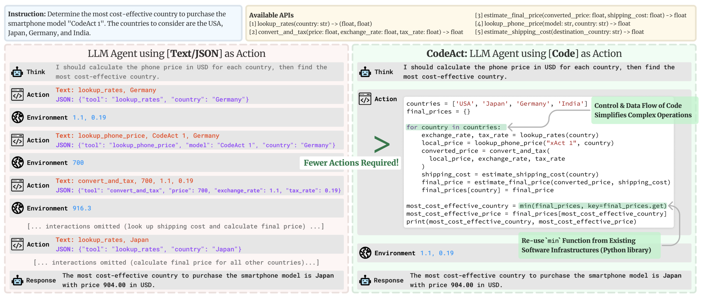

# 10 · Python or structured tool calls? { #week-3-action-formats }

**Objective:** understand two ways a model can request a tool. **Activity:** read and compare the two search examples, answer the questions, then create and run `my_tool_calling.py`. Compare its structured-call trace with the Python-action trace from `my_playlist.py` in Step 09.

## The same task, two formats { #two-representations }

**The question for this lesson is: how does the model tell your program which tool to run?** In Step 09, you used CodeAgent: the model wrote Python. Now you will also use ToolCallingAgent: the model supplies a tool name and its inputs as structured data.

Alfred needs to search for catering services and party ideas. In both reading examples, the tool is called `web_search`. Both need a real search function. The difference is how the model writes its requested action.

Follow this order: **read the two examples → answer the questions and reveal the guided answers → read the HF figure → run the program → compare your two execution records**. The first examples describe two searches; the program later uses the party-music task from Step 09.

### 1. Python actions { #python-example }

A CodeAgent can receive a Python action like this. **This is generated-action code to read, not a complete program to create or run.**

```python
for query in [
    "Best catering services in Gotham City",
    "Party theme ideas for superheroes"
]:
    print(web_search(f"Search for: {query}"))
```

- The list holds two search questions.
- The `for` loop takes one question at a time.
- `web_search(...)` runs the search tool.
- `print(...)` records the returned results for the agent to read.

Read the code in execution order:

1. On the first pass, `query` contains `Best catering services in Gotham City`.
2. `f"Search for: {query}"` inserts that value into a string, giving `Search for: Best catering services in Gotham City`. The `f` marks a formatted string; `{query}` is replaced with the variable's value.
3. Python calls `web_search(...)` with that text. When the tool returns, `print(...)` displays the result. The inner call happens before the outer `print`.
4. The loop repeats with `Party theme ideas for superheroes`. This is a second search.

**One Python action can therefore contain two tool calls.** That does not mean the search runs without a tool or without internet. The model proposes the Python code; CodeAgent's execution engine runs it on your PC, and the search function contacts the search service. The printed results become part of the observation returned to the model.

### 2. Structured tool calls { #structured-example }

A ToolCallingAgent requests a tool through structured data. JSON organizes values using labels. Here is an illustration of the same two searches. **Read it; do not create a JSON file or paste it into your Python program.**

```json
[
  {
    "name": "web_search",
    "arguments": {"query": "Best catering services in Gotham City"}
  },
  {
    "name": "web_search",
    "arguments": {"query": "Party theme ideas for superheroes"}
  }
]
```

Read the first item as **“Call `web_search` with the query ‘Best catering services in Gotham City’.”**

| Part | Read it as |
| --- | --- |
| `name` | Which tool should run? Here, `web_search`. |
| `arguments` | What values should be passed to that tool? |
| `query` | The input name expected by this search tool. |
| `"Best catering services in Gotham City"` | The value to pass as the search input. |
| The second item | Another request to the same tool, with a different query. |

There is no `for` loop in this JSON. It lists the two requests explicitly. ToolCallingAgent matches each tool name to a registered Python tool and passes in the arguments. The Python tool does the search; JSON itself cannot contact a search service.

This list is a **simplified illustration of the tool names and arguments**, not the full API response format. In your program, the model and SDK handle the structured messages. You do not write this JSON by hand.

**Neither Python code nor JSON is a search result.** The result appears only after software executes the tool.

## Activity: compare the two search examples { #comparison }

Compare **the Python `for` loop in Example 1** with **the JSON list in Example 2** above. Use the catering and party-theme examples for these questions. Try each question, then click **Show answer** to follow the reasoning.

**1. What tool do both examples use, and what are its two inputs?** Find the function name in Python and the `name` field in JSON.

??? success "Show answer"

    **Find the tool:** Python calls `web_search(...)`; JSON names `"web_search"`. They refer to the same search capability.

    **Find the inputs:** the first search is about catering services in Gotham City; the second is about superhero party themes. Python takes them from the two strings in the list. JSON puts each one under `arguments` → `query`.

    **Notice the small wording difference:** Python adds `Search for:` using the formatted string. JSON passes the search topic directly. They intend to search for the same two topics.

    **You could write:** “Both use `web_search`. The inputs ask for catering services in Gotham City and party themes for superheroes.”

**2. Where does each example say to perform two searches?** Count the loop inputs in Python and the request items in JSON.

??? success "Show answer"

    **Python:** there are two strings in the list. The `for` loop runs its indented body once for each, so the `web_search(...)` line executes twice.

    **JSON:** there are two request items. Each specifies a name and arguments. ToolCallingAgent handles those requests; the JSON data does not execute a loop.

    **You could write:** “Python repeats one instruction using a loop. JSON lists two separate tool requests. Both examples ask for two searches.” This is about these examples, not a rule that either agent always makes a fixed number of calls.

**3. Who chooses the action, and who executes it?** Separate the model on Groq from the program on your PC.

??? success "Show answer"

    **Choose:** the model on Groq reads the task and available tool descriptions, then proposes a tool and inputs. With CodeAgent, it expresses that choice in Python; with ToolCallingAgent, it uses a structured call.

    **Execute:** CodeAgent's local engine executes the Python, or ToolCallingAgent's local dispatcher calls the named tool with its arguments. The Python search tool contacts the search service.

    **Return:** the framework records the tool result as an observation and sends it back to the model when the loop continues.

    **You could write:** “The model proposes what to do. Python on my PC runs the tool. The framework connects the action and its returned observation.”

**4. Are these blocks search results? What is still missing?** Look for returned webpages or snippets, rather than instructions to search.

??? success "Show answer"

    **Neither block contains search results.** Both describe actions to execute. A query about catering is an input, not evidence that a catering service has been found.

    **What must happen next:** the registered Python tool must run and return results or an error. Those returned values are the observation. The model can use a successful result to answer or choose a further action.

    **You could write:** “These are requests, not results. I need to inspect the actual returned titles, URLs, and snippets before saying the search succeeded.”

## Code and JSON actions { #comparison-figure }

[](images/huggingface/code_vs_json_actions.png)

*Image credit: [Hugging Face Agents Course](https://huggingface.co/learn/agents-course/en/unit2/smolagents/tool_calling_agents). Select it to enlarge.*

The task in this figure is different from the party searches: **find the cheapest country in which to buy the same phone**, including currency conversion, tax, and shipping. Read the top instruction first, then compare the two sides.

- **Left — Text/JSON:** request an operation such as looking up an exchange rate, receive its result, then request the next operation. The figure leaves some repeated steps out.
- **Right — Code:** use a `for` loop to repeat the price calculation for each country, store the totals in `final_prices`, then use `min(..., key=final_prices.get)` to select the country with the lowest total.
- **Both:** still depend on tools that return the needed data. Code can group several operations into one action; this does not guarantee fewer model requests for every task. The illustrated prices are examples, not current prices.

**Try it:** point to the part that repeats work and the part that selects the cheapest country. Why can the right side express this as one block?

??? success "Show answer"

    **Find the repetition:** `for country in countries` repeats the same calculation for the USA, Japan, Germany, and India.

    **Follow one country:** get the exchange and tax rates, get the phone price, convert the price and include tax, get shipping, and calculate the final total. The code stores that total under the country's name in `final_prices`.

    **Find the comparison:** `min(final_prices, key=final_prices.get)` compares the stored totals and returns the country name with the smallest one. The following lookup gets its total price.

    **A guided answer:** “The code action uses a loop to repeat the tool calls and variables to keep their results. It can then compare those results in the same Python block. The left side expresses the operations as individual requests. Both still need their tools to run.”

## The loop { #tool-calling-loop }

**Changing the action format does not remove the loop.** In either program:

1. You give the agent a task.
2. The model requests an action.
3. The program executes it.
4. The result or error becomes the observation.
5. The model uses that observation to choose another action or finish.

## A structured-call program { #hf-agent-example }

You will now run the structured-call version of your Step 09 playlist program. It uses the **same task, Groq connection, and search tool**, so you can focus on the change in action format. The program below creates a ToolCallingAgent with a web-search tool. `build_model()` connects to Groq, `tools=[...]` registers the search tool, and `agent_options(action_format="tool")` supplies the structured-call settings.

## Create my_tool_calling.py { #groq-example }

Complete [Week 03 setup](week-3-learning-plan.md#exercise-files) first. Use the same project folder, existing environment, and Groq key.

1. Open **`First_agent_template`** in your code editor.
2. Choose **File → New Text File**, then **File → Save As**. Save it as **`my_tool_calling.py`** directly beside `app.py` and `week03_common.py`.
3. Paste the **whole code block below** into the file.
4. Save with **Ctrl + S** on Windows or **Command + S** on Mac. Use the exact `.py` filename, without `.txt`.

**What this file does — `my_tool_calling.py`:** Runs the same party-music search as my_playlist.py using ToolCallingAgent. The Groq model requests the search through a tool name and arguments; Python executes the search and the program prints the results and answer. Use its terminal record to compare structured calls with CodeAgent's Python actions.

```python title="my_tool_calling.py"
from smolagents import ToolCallingAgent
from week03_common import build_model, agent_options, run_task
from week03_search import WebSearchTool

model = build_model()
agent = ToolCallingAgent(
    tools=[WebSearchTool()],
    model=model,
    **agent_options(action_format="tool"),
)

task = "Search for the best music recommendations for a party at the Wayne's mansion."
raise SystemExit(run_task(agent, task))
```

??? info "Explain my_tool_calling.py"

    This program uses the same Groq connection, search tool, and party-music task as `my_playlist.py`.

    | Code | What it means |
    | --- | --- |
    | `from smolagents import ToolCallingAgent` | Load the agent that uses structured tool requests. |
    | `build_model()` and `WebSearchTool()` | Prepare the same model connection and search-tool instance used in Step 09. |
    | `agent = ToolCallingAgent(...)` | Create an agent that reads tool names and arguments from structured model requests. |
    | `tools=[WebSearchTool()]` and `model=model` | Give it the search tool and the prepared Groq connection. |
    | `**agent_options(action_format="tool")` | Supply settings for structured calls instead of Python-action instructions. |
    | `task = "Search ..."` | Ask for music recommendations for the same party. |
    | `raise SystemExit(run_task(agent, task))` | Run the loop, print the result, and exit with its success/error status. |

    The model still chooses the action, the Python search tool still runs on your PC, and the result still returns as an observation. The change is **how the model requests the action**.

**Run:** `python my_tool_calling.py`.

Enter your Groq key at the hidden prompt if asked, then press Enter. Read the output in the same terminal. This script does not open a browser interface.

## What to look for in the output { #execution-log }

A structured-call trace can show something like this:

```text
Calling tool: 'web_search' with arguments:
{'query': "best music recommendations for a party at Wayne's mansion"}
```

Find the tool name, input, returned search results, and final answer. Check that cited URLs occur in the returned results. A tool-call label alone does not prove that the search succeeded. If the run fails, record the actual error and follow [the troubleshooting guide](run-your-first-agent.md#troubleshooting) before retrying. Do not treat a failed search as a successful result.

## Which file are you working on? { #local-setup }

`my_playlist.py` from Step 09 uses CodeAgent and Python actions. `my_tool_calling.py` uses ToolCallingAgent and structured calls. They are separate terminal programs in `First_agent_template`; you do not need to edit the Week 2 `app.py`.

**Activity: compare your two runs.** Keep the terminal record from `my_tool_calling.py`. Put it beside the record from `my_playlist.py` in Step 09; rerun `python my_playlist.py` if you did not keep that record.

For **each** run, copy a short part of your actual output for these four items:

| Find | What to copy |
| --- | --- |
| Action | Generated Python, or the structured tool name and arguments. |
| Input | The search text passed to `query`. |
| Observation | A returned title, URL, or snippet; or the actual error if it failed. |
| Final answer | A sentence that uses the result. If no successful result was returned, record that limitation. |

Then answer: **what changed between the programs, and what stayed the same?**

??? success "Show answer"

    **Start with the first program:** in `my_playlist.py`, find model-generated Python such as a `web_search(...)` call. CodeAgent executes that Python. Your generated variable names and search text may differ from the reading example.

    **Now find the second program's action:** in `my_tool_calling.py`, look for `Calling tool: 'web_search'` and the `query` arguments. This reports a structured tool request. ToolCallingAgent calls the same Python search implementation.

    **Check what actually happened:** in each record, find the data returned after the call. Compare a URL in the final answer with a URL actually returned by the search tool. The two-line trace above only shows the request: it supplies no returned results or final answer, so you cannot use it alone to claim a successful search.

    **A guided comparison:** “In my playlist program, the model requested a search by writing Python. In my tool-calling program, it supplied a tool name and arguments. Both used Groq to choose the action and the same Python search tool on my PC to execute it. The result became an observation used for the answer.”

    Complete that comparison with **your own actual query and returned source**. If a run failed, write the error and say which evidence is missing. Do not invent a successful result. Search results and wording may differ between runs; the important comparison is the action format and execution flow.

## Checkpoint { #activity }

In your own words, answer: **does ToolCallingAgent replace the Python tool, and why do we still need the framework?**

??? success "Show answer"

    “ToolCallingAgent changes how the model requests an action. It still needs a registered Python tool to do the work. The model chooses a tool and inputs; the framework calls it, records its result or error, and uses that observation in the continuing loop. CodeAgent coordinates the same kind of loop but accepts Python actions.”

    You have reached the checkpoint when you can point to **a request, its execution result, and the answer that uses it** in your own record, and explain which part runs on Groq and which part runs on your PC.

## Credits { #sources }

Adapted from [Hugging Face Agents Course — Writing actions as code snippets or JSON blobs](https://huggingface.co/learn/agents-course/en/unit2/smolagents/tool_calling_agents), under the [Apache 2.0 license](licenses/huggingface-agents-course.txt).

**Next:** [11 · Tools: functions and classes](week-3-custom-tool.md).
