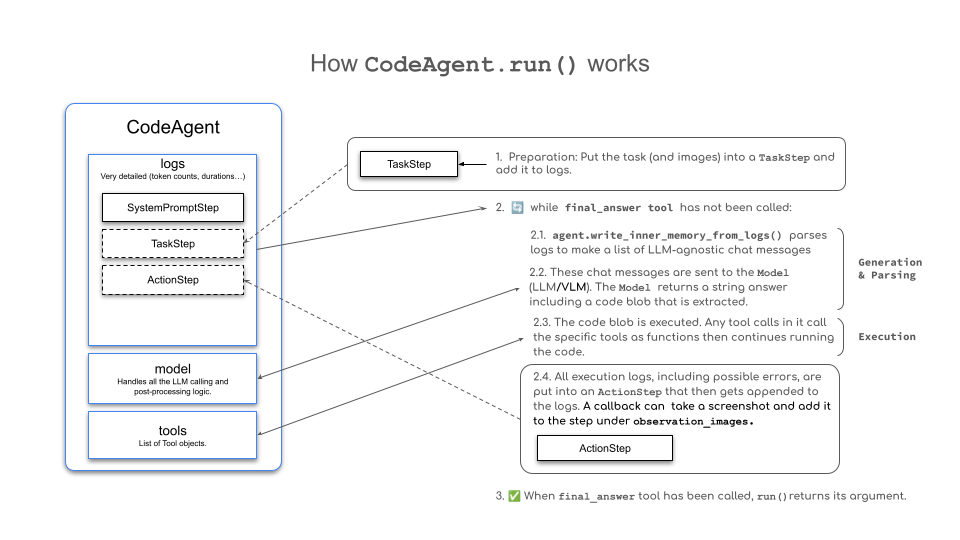
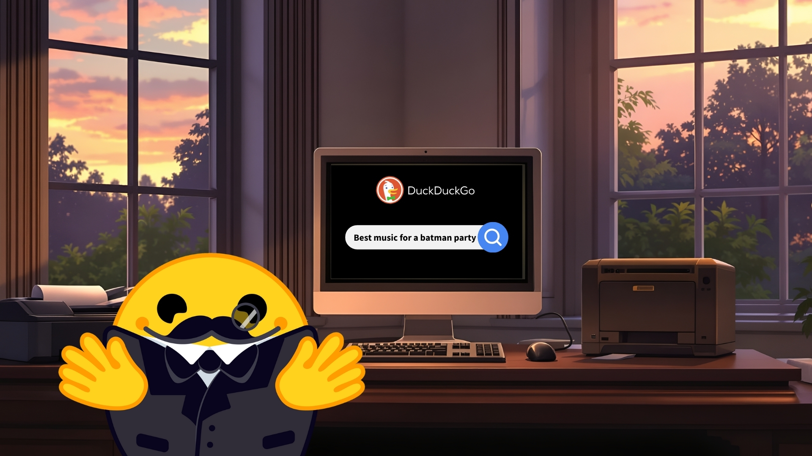

# 09 · Run a CodeAgent { #week-3-code-agent }

**Objective:** watch CodeAgent turn a question into Python, run it, and use the returned result. You will create three small programs: a playlist search, a menu selector, and a preparation-time calculator.

**Before starting:** finish [Week 03 setup](week-3-learning-plan.md#exercise-files). Your project folder must contain `.venv`, `app.py`, `week03_common.py`, `week03_search.py`, and `week03_tools.py`.

All new files in this lesson go directly inside **`First_agent_template`**, beside `app.py`. Write Python in your **code editor** and run each saved file in your terminal.

[](images/huggingface/alfred-party.jpg)

*Image credit: [Hugging Face Agents Course](https://huggingface.co/learn/agents-course/en/unit2/smolagents/code_agents). Select the image to enlarge it.*

## How the agent works { #actions }

CodeAgent can use Python variables, loops, calculations, and registered tools. Its loop is:

1. Send the task and available tool descriptions to the model on Groq.
2. Receive a proposed Python action.
3. Run that Python on your PC.
4. Record the returned value or error. This is the **observation**.
5. Send the observation back to the model, which can choose another action or finish.

[](images/huggingface/codeagent_docs.png)

*Image credit: [Hugging Face Agents Course](https://huggingface.co/learn/agents-course/en/unit2/smolagents/code_agents). Select the image to enlarge it.*

## A. Create a playlist-search program { #run-and-inspect }

**Goal:** let the model use a web-search tool to find music ideas.

[](images/huggingface/alfred-playlist.jpg)

*Image credit: [Hugging Face Agents Course](https://huggingface.co/learn/agents-course/en/unit2/smolagents/code_agents). Select the image to enlarge it.*

1. In your code editor, open your **`First_agent_template`** project folder.
2. Choose **File → New Text File**, then **File → Save As**. Save it as **`my_playlist.py`** directly beside `app.py` and `week03_common.py`.
3. Paste the **complete code below** into that file.
4. Save with **Ctrl + S** on Windows or **Command + S** on Mac. The filename must end in `.py`, not `.py.txt`.

**What this file does — `my_playlist.py`:** Runs an agent that searches the web for music for the party and prints a recommendation with retrieved links. Groq chooses the search query; the Python search tool on your PC fetches the results. Read the search steps and final answer in the terminal.

```python title="my_playlist.py"
from smolagents import CodeAgent
from week03_common import build_model, agent_options, run_task
from week03_search import WebSearchTool


model = build_model()
agent = CodeAgent(
    tools=[WebSearchTool()],
    model=model,
    **agent_options(),
)

task = "Search for the best music recommendations for a party at the Wayne's mansion."
raise SystemExit(run_task(agent, task))
```

??? info "Explain my_playlist.py"

    **This file creates a search agent and gives it a question.** Read it from top to bottom:

    | Code | What it means |
    | --- | --- |
    | `from smolagents import CodeAgent` | Load the class that coordinates the model, Python actions, and observations. |
    | `from week03_common import ...` | Load three supplied helpers: connect to Groq, get the classroom settings, and run/print the task. |
    | `from week03_search import WebSearchTool` | Load the supplied web-search tool class. |
    | `model = build_model()` | Prepare the Groq connection and ask for your key if needed. The task has not run yet. |
    | `agent = CodeAgent(...)` | Create the agent on your PC. |
    | `tools=[WebSearchTool()]` | Create a search-tool instance and make it available to this agent. The parentheses create the tool; they do not perform a search here. |
    | `model=model` | Give the agent the Groq connection created above. |
    | `**agent_options()` | Insert the supplied settings, including Python-action instructions, a four-step limit, and terminal logs. `**` passes the settings from a dictionary as named arguments. |
    | `task = "Search ..."` | Store your question as text. This line alone does not call the model or search the web. |
    | `raise SystemExit(run_task(agent, task))` | Run the task and print the result. The helper returns a success/error status; `SystemExit` finishes the program with that status. |

    **What happens when it runs:** Groq's model reads the task and may propose a `web_search(...)` call. CodeAgent executes that call on your PC; the tool contacts the search service. The returned snippets become an observation that the model can use to answer. The model can take more than one step.

    **Who does the work?** Groq chooses the action and writes the response. The local Python search tool retrieves the search results. CodeAgent coordinates the loop.


**Run:** `python my_playlist.py`. Enter your Groq key if prompted.

Read the output in the terminal.

**What to check:** find a `web_search(query=...)` call, the returned titles/URLs/snippets, and the final answer. Generated action code might look like the following. **Read this as an example of terminal output; do not create another file or paste it into your program.**

```python
results = web_search(query="best music for a Batman party")
print(results)
```

Your query and wording may differ. A cited URL should appear in the returned results. If search fails or returns no results, ask the teacher or use [the troubleshooting guide](run-your-first-agent.md#troubleshooting). An answer from model memory does not prove a search happened.

## B. Create a menu program { #menu }

**Goal:** watch the agent choose an input for a supplied Python function.

[](images/huggingface/alfred-menu.jpg)

*Image credit: [Hugging Face Agents Course](https://huggingface.co/learn/agents-course/en/unit2/smolagents/code_agents). Select the image to enlarge it.*

First, open the **existing** `week03_tools.py` in your editor and find `suggest_menu`. It is already supplied. The following block is for reading; leave that definition in its existing file.

```python
@tool
def suggest_menu(occasion: str) -> str:
    """
    Suggests a menu based on the occasion.
    Args:
        occasion (str): The type of occasion for the party. Allowed values are:
                        - "casual": Menu for casual party.
                        - "formal": Menu for formal party.
                        - "superhero": Menu for superhero party.
                        - "custom": Custom menu.
    """
    if occasion == "casual":
        return "Pizza, snacks, and drinks."
    elif occasion == "formal":
        return "3-course dinner with wine and dessert."
    elif occasion == "superhero":
        return "Buffet with high-energy and healthy food."
    else:
        return "Custom menu for the butler."
```

The function returns one of four fixed menu strings. The model chooses the `occasion`; Python returns the matching string. These are fictional demonstration menus, not live restaurant information.

Create the separate program that uses this function:

1. In your code editor, open your **`First_agent_template`** project folder.
2. Choose **File → New Text File**, then **File → Save As**. Save it as **`my_menu.py`** directly beside `app.py` and `week03_common.py`.
3. Paste the **complete code below** into that file.
4. Save with **Ctrl + S** on Windows or **Command + S** on Mac. The filename must end in `.py`, not `.py.txt`.

**What this file does — `my_menu.py`:** Runs an agent that interprets a menu request and uses the supplied menu function. For a formal occasion, the function returns the stored three-course dinner text; the agent uses that result to answer in the terminal. The menu comes from Python data, and the request is interpreted by the model on Groq.

```python title="my_menu.py"
from smolagents import CodeAgent
from week03_common import build_model, agent_options, run_task
from week03_tools import suggest_menu


model = build_model()
agent = CodeAgent(
    tools=[suggest_menu],
    model=model,
    **agent_options(),
)

task = 'Prepare a formal menu for the party.'
raise SystemExit(run_task(agent, task))
```

??? info "Explain my_menu.py"

    **This file gives the agent a menu-selection function instead of a search tool.**

    | Code | What it means |
    | --- | --- |
    | `from smolagents import CodeAgent` | Load the class that manages the agent loop. |
    | `from week03_common import ...` | Load the supplied Groq connection, classroom settings, and task runner. |
    | `from week03_tools import suggest_menu` | Load the function you read above from the existing `week03_tools.py` file. You do not redefine it in this file. |
    | `model = build_model()` | Prepare the Groq connection, using your key. |
    | `agent = CodeAgent(...)` | Create the local agent and give it a model and available tools. |
    | `tools=[suggest_menu]` | Register the function by name, without parentheses. This makes it available for a later action; it does not call it during setup. |
    | `model=model` | Tell the agent which model connection to use. |
    | `**agent_options()` | Pass the supplied Python-action instructions, step limit, and logging settings into CodeAgent. |
    | `task = 'Prepare a formal menu for the party.'` | Store the request that the model will interpret. You can change this sentence for the next experiment. |
    | `raise SystemExit(run_task(agent, task))` | Start the model/action/observation loop, print the result, and finish with the returned success/error status. |

    **A valid run:** the model interprets “formal” and proposes `suggest_menu(occasion="formal")`. Python executes that function and returns `3-course dinner with wine and dessert.` The model then uses that observation in its answer.

    **Where does the menu come from?** It is a fixed string inside `week03_tools.py`. The model chooses the input and reports the result; the function supplies the menu. Inspect the trace to confirm the call actually happened.


**Run:** `python my_menu.py`.

Read the output in the terminal.

**What to check:** look for `suggest_menu(occasion="formal")`, followed by `3-course dinner with wine and dessert.` The final answer should use that result.

**Try a change:** in **`my_menu.py`**, replace the `task` sentence with `Prepare a superhero menu for the party.` Save the file and rerun `python my_menu.py` in the same activated terminal. The function should return `Buffet with high-energy and healthy food.`

## C. Create a preparation-time program { #limits-and-recovery }

**Goal:** let the agent use the permitted `datetime` Python module. The tasks take 30 + 60 + 45 + 45 minutes. Assume one person does them in order: **180 minutes, or three hours**.

1. In your code editor, open your **`First_agent_template`** project folder.
2. Choose **File → New Text File**, then **File → Save As**. Save it as **`my_timing.py`** directly beside `app.py` and `week03_common.py`.
3. Paste the **complete code below** into that file.
4. Save with **Ctrl + S** on Windows or **Command + S** on Mac. The filename must end in `.py`, not `.py.txt`.

**What this file does — `my_timing.py`:** Asks an agent when party preparation will finish if one person starts now and completes the four tasks in order. The model on Groq proposes Python using datetime; your PC executes it to add the total preparation duration to its current local time. The start time, finish time, and answer appear in the terminal.

```python title="my_timing.py"
from smolagents import CodeAgent
from week03_common import build_model, agent_options, run_task


model = build_model()
agent = CodeAgent(
    tools=[],
    model=model,
    additional_authorized_imports=["datetime"],
    **agent_options(),
)

task = """Alfred needs to prepare for the party. Here are the tasks:
1. Prepare the drinks - 30 minutes
2. Decorate the mansion - 60 minutes
3. Set up the menu - 45 minutes
4. Prepare the music and playlist - 45 minutes

If we start right now, at what time will the party be ready?
Assume one person completes the tasks in order. Use datetime for the current local
PC time, add the total duration, and print both times before answering."""
raise SystemExit(run_task(agent, task))
```

??? info "Explain my_timing.py"

    **This file asks the agent to calculate a finish time using Python.**

    | Code | What it means |
    | --- | --- |
    | `from smolagents import CodeAgent` | Load the class that coordinates Python actions and model requests. |
    | `from week03_common import ...` | Load the Groq connection, classroom settings, and task runner. |
    | `model = build_model()` | Prepare the connection to the model on Groq. |
    | `agent = CodeAgent(...)` | Create the agent that will handle the timing question. |
    | `tools=[]` | Register no custom tools or web-search tool. The agent can still use permitted Python operations and smolagents' built-in `final_answer` tool. |
    | `model=model` | Give the agent the prepared Groq connection. |
    | `additional_authorized_imports=["datetime"]` | Allow model-generated Python to import `datetime` for dates, times, and time differences. This setting permits the import; it does not perform the calculation. |
    | `**agent_options()` | Supply the Python-action instructions, four-step limit, and terminal logs. |
    | `task = """..."""` | Store a request across several lines. Triple quotes allow the task list and instructions to stay together as one string. |
    | `raise SystemExit(run_task(agent, task))` | Run the agent, print its result, and finish with the returned success/error status. |

    **The numbers in the task:** 30 + 60 + 45 + 45 = **180 minutes**. The sentence about one person working in order tells the agent to add all four durations.

    **What happens when it runs:** Groq's model proposes Python that reads the PC's current local time and adds the duration, for example using `datetime.datetime.now()` and `datetime.timedelta(minutes=180)`. CodeAgent executes it locally. The observation supplies the starting and finish times for the model's answer.

    **Where does “now” come from?** Your PC's clock and local time-zone setting. A later run can give a different finish time. Check the actual generated code and printed times.


**Run:** `python my_timing.py`.

Read the output in the terminal.

**What to check:** the generated Python should get the PC's current local time and add three hours. Find the starting time, duration, and finish time in the execution output. The answer changes with the PC clock.

## Read the record { #read-the-record }

| Record | Meaning |
| --- | --- |
| Model text / “Thought” | A generated explanation of the intended action; it is not evidence that it ran. |
| Python action | The code proposed by the model. |
| Observation | The actual returned result or error. |
| Final answer | What the agent reports; check it against the observation. |

**Checkpoint:** show one **action → observation → final answer** sequence for your menu and timing programs, and record the actual outcome of your playlist search.

## Credits { #sources }

Lesson and examples adapted from [Hugging Face Agents Course — Building Agents That Use Code](https://huggingface.co/learn/agents-course/en/unit2/smolagents/code_agents), under the [Apache 2.0 license](licenses/huggingface-agents-course.txt).

**Next:** [Step 10 — Python or structured tool calls?](week-3-action-formats.md).
