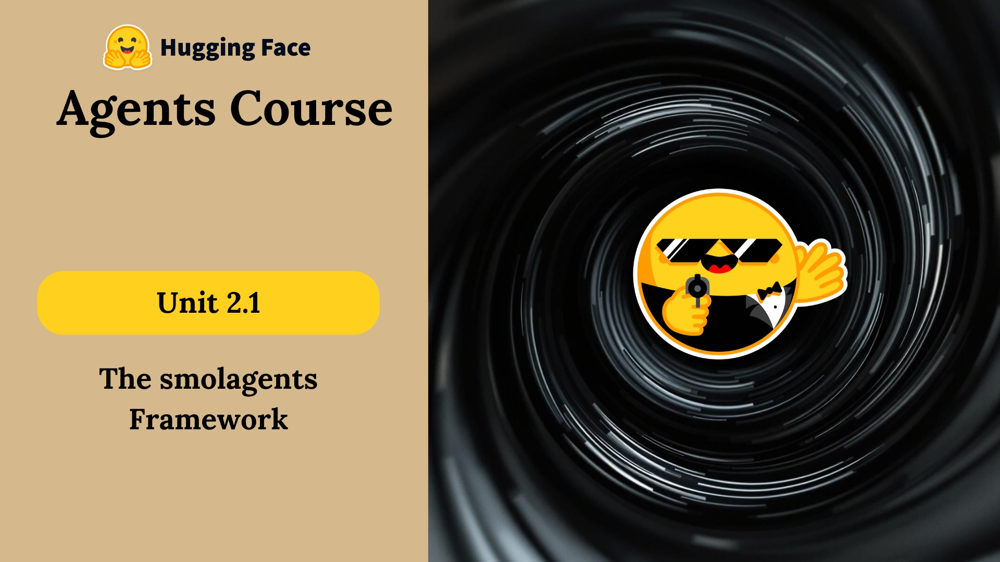

# 08 · Introduction to smolagents { #week-3-framework }

**Objective:** understand what the model, the framework, and your Python tools each do. **Activity: reading.** No file creation or program run is required on this page.

## How this week builds on Weeks 1–2 { #builds-on-previous-weeks }

**You already used smolagents and CodeAgent in Week 2.** This week uses the same library, Groq key, and Python environment. The goal is to deepen your understanding of how an agent and its tools work together by building and changing small programs yourself.

| Week | What you focus on |
| --- | --- |
| **Week 1** | Learn the agent idea, set up your PC, and follow a simple dummy agent step by step. |
| **Week 2** | Get an existing browser-chat template working, register its supplied time and search tools, and check their results. CodeAgent already manages the loop. |
| **Week 03** | Create small Python agent programs from the lesson code, run them in the terminal, and follow each action and observation. Compare Python actions with structured tool calls, understand function and class tools, and change a tool's data. |

**What is different?** You already registered supplied tools in Week 2, and may have tried the optional custom-tool challenge. Week 03 builds on that experience: you study the tool descriptions and Python implementation, compare a decorated function with a tool class, test them directly, and trace how the model uses their results. In Week 2, you worked inside a ready-made chat app. Now you put the model, tools, and task together in short files where each part is easier to see. The model still proposes actions, Python still executes them, and CodeAgent still coordinates the loop.

*Image credit: [Hugging Face Agents Course](https://huggingface.co/learn/agents-course/en/unit2/smolagents/introduction). Select it to enlarge.*

## Meet Alfred { #introduction }

Alfred is a fictional assistant organizing a superhero-themed party at Wayne Manor. He needs to find music, choose a menu, and arrange catering and a party theme. We will use those tasks to understand agents.

This week ends after tools. [Week 04](week-4-preview.md) will continue with retrieval and later topics.

## What the framework does { #what-the-framework-does }

**smolagents is a Python library for building agents.** It provides CodeAgent and the machinery around the model/tool loop.

- **The model on Groq** reads the request and proposes an action.
- **Python on your PC** executes the action and returns a result or error.
- **CodeAgent on your PC** coordinates the requests, execution, observations, and final answer.

A framework keeps the task and execution history, presents the available tools to the model, runs the proposed actions, and sends the observations back. You still choose the tools, describe their inputs, register them, and check the outcome.

## When is it useful? { #when-useful }

A framework helps you start with relatively little code and try ideas quickly. It is useful when a model needs to choose a tool or work through several steps.

For example, if a program already has `15` and `30` and knows to add them, a direct Python function is enough. If the input is “What are 15 and 30 together?”, a model can interpret the language and choose addition. For a task such as “find music ideas for the party,” the model can choose a search and use the returned results.

A framework helps organize this work; it does not guarantee a correct answer. Check that the tools actually ran and that the answer follows their returned values.

## Two ways to request an action { #agent-types }

- **CodeAgent:** the model proposes Python code. The execution engine runs it.
- **ToolCallingAgent:** the model requests a tool using structured data. The framework reads that request and calls the function.

Both can follow **action → observation → another action or final answer**. Step 10 explains the two formats.

*Image credit: [Hugging Face Agents Course](https://huggingface.co/learn/agents-course/en/unit2/smolagents/why_use_smolagents). Select it to enlarge.*

## Where everything runs { #model-integration }

Our programs connect to Groq through the supplied `build_model()` function in `week03_common.py`. It asks for the same Groq key you used in Week 2. The LLM runs remotely, so model requests need internet access.

CodeAgent and the tools run on your PC. Installing smolagents does not install the LLM on your PC. A Python tool such as the menu selector can be called directly without Groq; asking an agent to choose and use that tool involves the model.

## Checkpoint { #activity }

Explain in your own words: **the model proposes actions, Python executes them, and the framework coordinates the loop.**

## Optional quiz { #original-reading }

Try [HF Quick Quiz 1](https://huggingface.co/learn/agents-course/en/unit2/smolagents/quiz1). The quiz is hosted by HF; this site does not collect its score.

## Credits { #sources }

Adapted from [Introduction to smolagents](https://huggingface.co/learn/agents-course/en/unit2/smolagents/introduction) and [Why use smolagents?](https://huggingface.co/learn/agents-course/en/unit2/smolagents/why_use_smolagents), under the [Apache 2.0 license](licenses/huggingface-agents-course.txt).

**Next:** [09 · Run a CodeAgent](week-3-code-agent.md).
