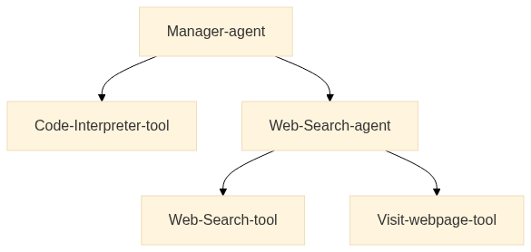
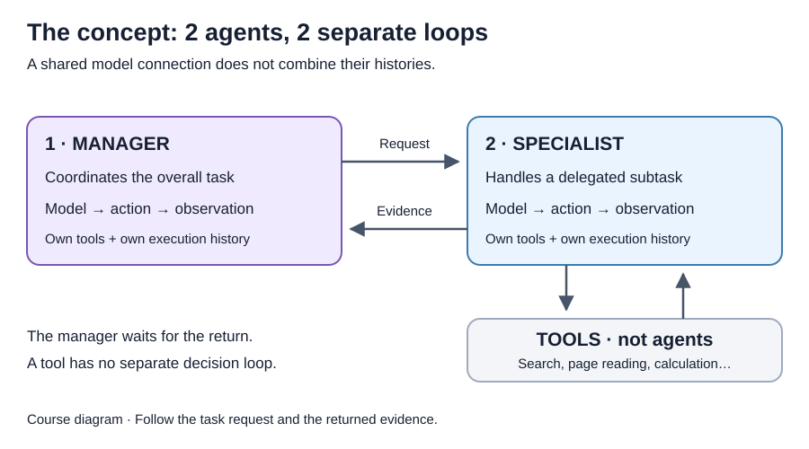
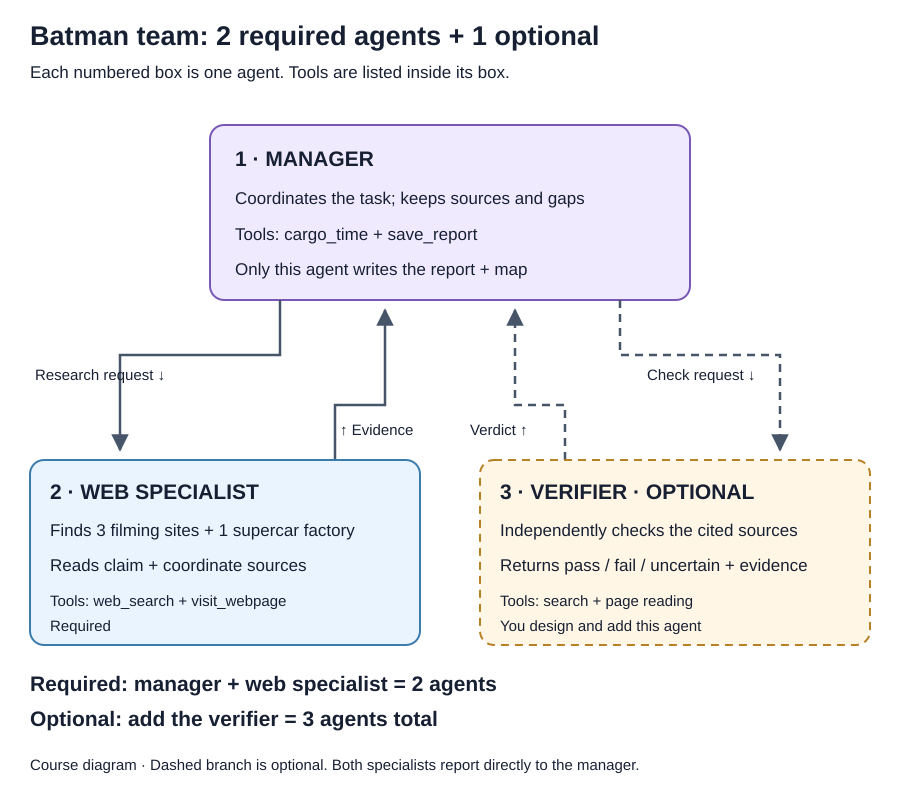
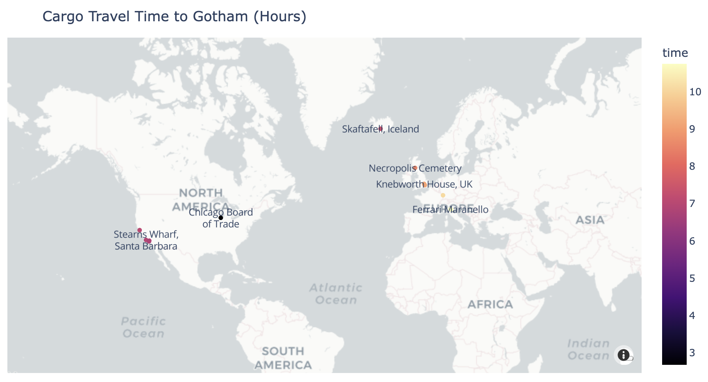

# 15 · Multi-agent systems { #week-4-batman }

**English / 日本語:** Each section has a Japanese panel. Use the shared code once. The separate language-switch destination still has the earlier edition; use the Japanese panels here for these updates. Updated setup and search/retry steps are on this page. / 各節の「日本語」を開いてください。この2ページの更新は同じページ内の日英で読めます。上部の言語切り替え先は以前の版です。コードは共通で、1回だけ貼り付けます。設定・検索・再試行の更新はこのページで確認してください。


*Reference: [Hugging Face Multi-Agent Systems](https://huggingface.co/learn/agents-course/en/unit2/smolagents/multi_agent_systems). Follow the arrows: a request goes down and evidence must come back up.*

**Objective:** understand agent roles and delegation, then build the Batman research team.

Start with **Part A: how agents work together**, then build the Batman team in **Part B**. Adding a third agent is optional.

??? info "日本語 — 15 · マルチエージェントシステム"

    *参考：[Hugging Face Multi-Agent Systems](https://huggingface.co/learn/agents-course/en/unit2/smolagents/multi_agent_systems)。矢印をたどり、下へ渡る依頼と、上へ返る根拠を確認してください。*

    **目標：**エージェントの役割と委任を理解し、Batman調査チームを作ります。

    まず**Part Aでエージェントの連携**を学び、**Part BでBatmanチーム**を作ります。3体目の追加は任意です。

## Part A · Understand multi-agent systems { #multi-agent-concepts }

[](images/huggingface-week04/multi-agent-architecture.png){ .course-figure-link }

*Figure from Hugging Face, unchanged. [Open the full-size figure](images/huggingface-week04/multi-agent-architecture.png).*

??? info "日本語 — Part A · マルチエージェントの仕組み"

    ??? info "この図の説明を読む"

        管理役がタスクを受け、必要な作業をコードツールやWeb調査役へ渡す構成です。管理役から下向きの矢印は依頼、調査役から戻る矢印は調査結果を表します。Web調査役は自分で検索やページ閲覧を選ぶループを持ちます。コードツールの呼び出しは、それ自体がもう1体のエージェントになるわけではありません。結果が管理役へ戻るとき、出典や不確かな点も一緒に渡す必要があります。図をクリックすると拡大できます。

    *Hugging Faceの図を変更せず使用しています。[元の大きさで開く](images/huggingface-week04/multi-agent-architecture.png)。*

### 1. What makes a system multi-agent? { #why-teams }

An **agent** has a model-driven decision loop, instructions, tools and its own execution history. A **multi-agent system** connects two or more of these agents so they can divide work and exchange results. A **role** describes a responsibility; a **handoff** is the request and information passed between agents.

A single CodeAgent can search, read pages, calculate, and write a report. That makes it a useful baseline: there is only one execution history to inspect. However, a long research task puts search snippets, page text, calculation output, and reporting decisions into that same history. An agent may spend attention on details irrelevant to its current job, repeat searches, or lose the sources needed for a later step.

A manager/specialist design gives research its own model–action–observation loop. The manager sends a goal; the specialist decides which queries and pages to use; the specialist returns a compact report. The manager continues using that report. This is different from a function tool, which runs the specified Python operation and returns its result without making its own sequence of model decisions.

Both agents can share one model connection and key while maintaining different histories and available tools. Two agents do not automatically mean parallel execution: in this exercise the manager waits for the specialist's return. The handoff can reduce irrelevant detail in the manager's context, but it can also discard important evidence. Extra model calls and coordination can make a team slower or more expensive. You must evaluate the trace rather than assume that a team is better.

[](images/week04/multi-agent-concept.svg){ .course-figure-link }

*Course diagram: **2 agents** with separate loops. Tools are not additional agents. [Enlarge the diagram](images/week04/multi-agent-concept.svg).*

??? info "日本語 — 1. マルチエージェントとは？"

    **エージェント**は、モデルが判断するループ、指示、ツール、自分の実行履歴を持ちます。**マルチエージェントシステム**は、このようなエージェントを2体以上つなぎ、作業を分担して結果を受け渡す仕組みです。**役割（role）**は担当する仕事、**受け渡し（handoff）**はエージェント間で渡す依頼と情報です。

    1体のCodeAgentでも検索、ページ閲覧、計算、レポート作成はできます。履歴が1つなので、動きを追いやすい利点があります。ただし、長い調査では検索の抜粋、ページ本文、計算結果、レポートの判断が同じ履歴にたまります。不要な詳細に注意を取られ、同じ検索を繰り返したり、後で必要な出典を見失ったりすることがあります。

    管理役と専門役に分けると、調査側に独自の「モデル → アクション → 観測」のループができます。管理役が目標を渡し、専門役が検索語や読むページを選び、短い報告を返します。管理役はその報告を使って続きを進めます。決められたPython処理を実行して値を返す関数ツールとは、この点が異なります。

    2体で同じモデル接続とキーを共有しても、履歴や使えるツールは別々です。また、2体いるからといって並列実行になるとは限りません。この演習では管理役が専門役の返答を待ちます。受け渡しで管理役の履歴を整理できる一方、大事な根拠が失われる可能性もあります。問い合わせと連携が増えると、時間や費用が増えることもあります。チームのほうが良いと決めつけず、実際の記録で評価してください。

    ??? info "この図の説明を読む"

        左の**1 · MANAGER**が全体を管理する役、右の**2 · SPECIALIST**が特定の仕事を担当する役です。それぞれに「Model → action → observation」という独立したループがあります。上の右向きの矢印**Request**は依頼、下の左向きの矢印**Evidence**は返された根拠です。専門役の下の**TOOLS**は検索やページ閲覧などの処理で、追加のエージェントには数えません。この図のエージェントは**合計2体**です。

    *教材の図：別々のループを持つ**2体のエージェント**です。ツールは追加のエージェントではありません。[図を拡大する](images/week04/multi-agent-concept.svg)。*

### Check the concept before the example { #concept-check }

**1. A manager delegates to one researcher and calls a calculator. How many agents are there?**

??? success "Concept answer 1 — count the loops"

    **Two agents:** manager and researcher. The calculator is a tool that runs a defined operation; it is not a third model-driven loop.

**2. If both agents share one model connection, are they the same agent?**

??? success "Concept answer 2 — connection versus agent"

    No. They remain separate agent objects with their own histories, instructions and available tools. A different model is not required for each role.

**3. Does a manager/specialist diagram mean the agents run in parallel or that the answer is verified?**

??? success "Concept answer 3 — inspect execution"

    No. In this exercise the manager waits for the specialist. Check the trace for actual delegation and inspect the returned sources; an extra agent or a diagram does not guarantee correctness.

??? info "日本語 — 例に進む前の確認"

    **1. 管理役が1体の調査役に委任し、計算ツールも呼びます。エージェントは何体ですか？**

    ??? success "確認1 — ループを数える"

        管理役と調査役の**2体**です。計算ツールは定められた処理を行うもので、3体目のモデル判断ループではありません。

    **2. 2体で1つのモデル接続を共有すると、同じエージェントになりますか？**

    ??? success "確認2 — 接続とエージェントの違い"

        なりません。別々のエージェントとして、それぞれの履歴、指示、使えるツールを持ちます。役割ごとに別のモデルを用意する必要はありません。

    **3. 管理役と専門役の図があれば、並列実行や回答の検証ができていると言えますか？**

    ??? success "確認3 — 実行を調べる"

        言えません。この演習では管理役が専門役を待ちます。実際の委任と返された出典を確認してください。図やエージェントの追加だけでは正しさを保証できません。

## Part B · Main exercise: Batman research team { #batman-exercise }

**Your task:** build a web specialist and a manager that work together to research locations, check sources and create a report.

Alfred needs a shortlist of places where a replacement Batmobile might be found. Your team must research **three Batman filming locations and one supercar factory**, preserve the evidence for their roles and coordinates, calculate a classroom cargo-flight estimate to fictional Gotham, and produce a sourced table and colored coordinate map.

First, check the research tools. Then create the specialist and manager, connect them, and test one filming claim before researching all four locations. Answer each check as you go and keep your results in `evidence.md`.

**Before starting:** complete [Week 4 setup](week-4-preview.md#exercise-files) and [create `evidence.md` and `evidence-files`](week-4-preview.md#evidence-file). Use the **Topic 15** section of that note for your answers and results.

| File | Where it comes from / what you do |
| --- | --- |
| `week04_common.py`, `week04_search.py`, `week04_tools.py` | Supplied in the ZIP. Open the existing files when asked; do not recreate them. |
| `my_batman_tools.py`, `my_batman.py` | Create these in `week04-exercises` by following steps 3 and 4. |
| `my_batman_verified.py` | Not supplied. Create a copy of your working team only for the optional extension. |
| `evidence.md` | Created by you in setup; save your answers and terminal excerpts here. |
| `outputs/batman-report.html` | Generated when the report tool succeeds. Do not create an empty HTML file. |

Use the same activated `week04-exercises` terminal throughout. The research and model traces appear there; only the generated report is opened in a browser.

??? info "日本語 — Part B · メイン演習：Batman調査チーム"

    **課題：**Web調査役と管理役を作り、地点の調査、出典の確認、レポートの作成を連携して行わせます。

    アルフレッドは、代わりのバットモービルが見つかりそうな場所の候補を必要としています。**Batmanの撮影地3か所とスーパーカーメーカーの工場1か所**を調べ、その用途と座標の根拠を残してください。架空のゴッサムまでの貨物航空輸送時間を授業用の式で概算し、出典付きの表と色分けした座標図を作ります。

    最初に調査ツールを確認します。その後、専門役と管理役を作ってつなぎ、1件の撮影情報を確認してから4地点へ進みます。各確認問題に答え、結果を`evidence.md`に残してください。

    **始める前に：**[第04週の準備](week-4-preview.md#exercise-files)と、[記録用の`evidence.md`、`evidence-files`の作成](week-4-preview.md#evidence-file)を終えます。この演習の回答と結果は、メモの**Topic 15**に記入します。

    | ファイル | 配布・作成・生成の区別 |
    | --- | --- |
    | `week04_common.py`、`week04_search.py`、`week04_tools.py` | ZIPに入っています。指定されたときに既存のファイルを開きます。作り直す必要はありません。 |
    | `my_batman_tools.py`、`my_batman.py` | 手順3、4に沿って`week04-exercises`内に作ります。 |
    | `my_batman_verified.py` | 配布されません。任意課題に取り組むときだけ、動作しているチームのコピーを作ります。 |
    | `evidence.md` | 準備で作成したファイルです。回答とターミナルの抜粋を保存します。 |
    | `outputs/batman-report.html` | レポートツールが成功したときに生成されます。空のHTMLファイルを自分で作らないでください。 |

    すべて、環境を有効にした同じ`week04-exercises`のターミナルで実行します。調査やモデルの記録はターミナルで読み、生成したレポートだけをブラウザで開きます。

### See the required team and the optional extension { #team-roles }

[](images/week04/batman-agent-roles.svg){ .course-figure-link }

*Course diagram: **required = manager + web specialist (2 agents)**. **Optional = add a verifier (3 agents total)**. [Enlarge the diagram](images/week04/batman-agent-roles.svg).*

The web specialist researches. The manager coordinates, calculates and saves. In the optional challenge, add a verifier that independently checks one researched record and returns a verdict. Both specialists report to the manager; the verifier is a separate agent, not a second name for the researcher. The search/page tools, calculator and report writer do not increase the agent count.

**Think before coding:** suppose the specialist returns only “Wollaton Hall is a good candidate.” What can the manager verify? What information would you need to draw the map and check the source?

??? success "Reasoning check"

    The statement lacks a supporting page, coordinates and their source, the filming/factory category, and uncertainty. A persuasive summary is not a usable research record. The manager cannot reconstruct missing evidence reliably from the specialist's confidence.

??? info "日本語 — 必須の2体と任意の追加を確認する"

    ??? info "この図の説明を読む"

        **1 · MANAGER**が管理役で、調査を依頼し、出典と不足情報を保ちながら`cargo_time`と`save_report`を使います。最終レポートと地図を書くのはこの役だけです。左下の**2 · WEB SPECIALIST**が調査役で、撮影地3か所と工場1か所の候補、用途と座標の出典を調べます。この**管理役＋Web調査役の2体が必須**です。

        右下の点線の枠**3 · VERIFIER · OPTIONAL**が任意の検証役です。追加すると**合計3体**になります。引用されたページを独立して読み、`pass`、`fail`、`uncertain`と根拠を返します。点線は追加した場合の依頼と判定の受け渡しです。調査役と検証役はどちらも管理役へ直接報告します。ツールは各枠の中に書かれており、エージェントの人数には含めません。

    *教材の図：**必須は管理役＋Web調査役の2体**、**任意で検証役を加えると合計3体**です。[図を拡大する](images/week04/batman-agent-roles.svg)。*

    Web調査役が調べ、管理役が全体の調整、計算、保存を行います。任意課題では、調査結果1件を独立して確認し判定する検証役を加えます。検証役は調査役の別名ではなく、別のエージェントです。検索・ページ閲覧・計算・レポートの各ツールは、人数を増やすものではありません。

    **コードを書く前に：**専門役が「Wollaton Hallは良い候補です」としか返さなかったら、管理役は何を確かめられるでしょうか？地図の作成と出典の確認には、どの情報が必要ですか？

    ??? success "考え方を確認する"

        裏付けるページ、座標とその出典、撮影地か工場かという区分、不確かな点が足りません。説得力のある要約だけでは調査記録として使えません。専門役の自信だけから、管理役が不足した根拠を復元することはできません。

### 2. Understand each agent’s role { #plan }

The table shows what each agent will do. Before writing the code, explain the two roles in your own words under Topic 15 in `evidence.md`.

| Part | What you will give it |
| --- | --- |
| Web specialist | `WebSearchTool(budget=budget)` and `PageExcerptTool(budget=budget)`; the name `web_specialist` and a description of its research role. |
| Manager | `cargo_time` and `save_report`; access to the specialist through `managed_agents=[specialist]`. |
| Handoff | A supported location/role, coordinates when established, a claim source URL, a coordinate source URL and evidence/uncertainty. |
| Small test | The complete `ONE_LOCATION_TASK` checks one building and asks for a sourced return, without saving a report. |
| Full task | The complete `TASK` asks for three distinct filming sites and one supercar factory, calculations and a saved table/map. |

The fields for a supported report row are `location`, `kind` (`filming` or `factory`), `latitude`, `longitude`, `source_url`, `coordinate_source_url` and `evidence`. A filming source may not establish the coordinate. Missing evidence should be reported, not invented; unsupported coordinates must not become fabricated calculator inputs.

```text
Given task → manager → web_specialist(task="a research goal")
                           ↓ web_search → visit_webpage
                     sourced report → manager
                           ↓ cargo_time → save_report (full task only)
                     outputs/batman-report.html
```

**1. Why does the specialist have search/page tools while the manager has the calculator/report tools?**

??? success "Answer 1 — each agent’s role"

    The specialist gathers evidence in its own loop. The manager requests that research, uses the returned coordinates for calculations and saves the report. This separation makes delegation visible; the manager has no direct search tool to bypass it.

**2. Why should the specialist include source URLs and any uncertainty in its reply?**

??? success "Answer 2 — usable evidence"

    You and the manager need to check what supports each claim and coordinate. A conclusion without its evidence cannot reliably support the calculation or audit. Missing fields should remain explicitly missing until resolved.

??? info "日本語 — 2. 各エージェントの役割を理解する"

    下の表で担当を確認します。コードを書く前に、2つの役割を自分の言葉で`evidence.md`のTopic 15に説明してください。

    | 部分 | 渡すもの・担当すること |
    | --- | --- |
    | Web調査役 | `WebSearchTool(budget=budget)`と`PageExcerptTool(budget=budget)`、呼び出し名`web_specialist`、調査の役割を伝える説明文。 |
    | 管理役 | `cargo_time`と`save_report`。`managed_agents=[specialist]`で調査役へ委任できます。 |
    | 受け渡し | 裏付けのある地点と用途、確認できた場合の座標、用途の出典URL、座標の出典URL、根拠と不確かな点。 |
    | 小さなテスト | `ONE_LOCATION_TASK`が建物1件の情報と出典を求めます。レポートは保存しません。 |
    | 全体のタスク | `TASK`が異なる撮影地3か所と工場1か所、計算、表・座標図の保存を求めます。 |

    レポートの1行に必要な項目は`location`、`kind`（`filming`または`factory`）、`latitude`、`longitude`、`source_url`、`coordinate_source_url`、`evidence`です。撮影情報の出典だけでは、座標を確認できない場合もあります。不足している根拠は不足として示し、計算用の座標を推測で作らないでください。

    （コード・コマンド・入力例は上の共通ブロックを使ってください。）
    **1. 調査役に検索・ページ閲覧ツールを持たせ、管理役に計算・レポートツールを持たせるのはなぜですか？**

    ??? success "解答1 — それぞれの担当"

        調査役は自分のループで根拠を集めます。管理役はその調査を依頼し、返された座標で計算して保存します。管理役が直接検索できないため、委任の動きが分かりやすくなります。

    **2. 専門役が返答に出典URLと不確かな点を含めるべきなのはなぜですか？**

    ??? success "解答2 — 使える根拠"

        自分と管理役が、各主張と座標の裏付けを確認するためです。根拠のない結論では計算や点検を支えられません。足りない項目は解決するまで不足として残します。

### 3. Check tools and explain the estimate { #tool-check }

**Goal:** test the supplied tools without an LLM before asking a team to use them.

1. In your editor, open **`week04-exercises`**, where `requirements.txt` and `week04_common.py` are visible.
2. Choose **File → New Text File → Save As** and save **`my_batman_tools.py`** directly beside those files. **It is not supplied in the ZIP; create it now.**
3. Paste the complete code below, then save with **Ctrl + S** (Windows) or **Command + S** (Mac).
4. Check the name ends in `.py`, not `.py.txt`. Keep this file out of `.venv`, `lessons` and `assets`.

Start with the query and URL in the code below. Read what each call returns. If the page is unavailable, record the error and check the source in your browser.

**What this file does — `my_batman_tools.py`:** Searches public web data, fetches one page, and checks a fixed coordinate through the supplied calculator. It uses no LLM. Inspect the terminal output and source page.

**Use the current search wrapper below.** An older download or example may use `DuckDuckGoSearchTool` from smolagents. Replace that import and constructor in your own program with the `WebSearchTool` defined here. The current supplied helper already uses DDGS with a DuckDuckGo-only backend; this wrapper uses `backend="auto"` so DDGS can choose a search backend. Keep the supplied helper unchanged. It still provides `ResearchBudget`, `PageExcerptTool` and `clip`.

The `if __name__ == "__main__"` guard runs the three direct checks only when you run this file. Importing its `WebSearchTool` in 4A will not run another search. The wrapper keeps one-search budgets, at most two results, and a 1,400-character output cap; failures count as attempts. DDGS calls a web search service, **not Groq**, so this check needs no Groq key and spends no Groq tokens. It still needs internet and can be blocked or return no results. A snippet is a candidate source, not verified evidence.

```python title="my_batman_tools.py"
from ddgs import DDGS
from week04_search import ResearchBudget, PageExcerptTool, clip
from week04_tools import cargo_time
from smolagents import Tool


class WebSearchTool(Tool):
    name = "web_search"
    description = "Find candidate sources, not verified facts. Returns at most two short snippets and URLs."
    inputs = {"query": {"type": "string", "description": "One focused search query."}}
    output_type = "string"

    def __init__(self, budget=None):
        super().__init__()
        self.budget = budget or ResearchBudget()

    def forward(self, query: str) -> str:
        refusal = self.budget.allow("search", query.strip().casefold())
        if refusal:
            return refusal
        try:
            results = list(DDGS(timeout=12).text(
                query[:240], max_results=2, backend="auto"
            ))[:2]
            entries = []
            for item in results:
                url = str(item.get("href", ""))
                if not url.startswith(("https://", "http://")) or len(url) > 350:
                    continue
                entries.append(f"[{str(item.get('title', 'Source'))[:90]}]({url})\n"
                               + str(item.get("body", ""))[:220])
            return clip("\n\n".join(entries), 1400) if entries else "No usable results. Mark evidence missing."
        except Exception:
            return "Search failed; attempt counted. Record missing evidence. Do not invent sources."


if __name__ == "__main__":
    print("Same-coordinate classroom estimate:", cargo_time(40.7128, -74.0060))
    print(WebSearchTool()("Batman Wollaton Hall filming official"))
    print(PageExcerptTool()("https://wollatonhall.org.uk/hall-and-museum/history/", focus="Wayne Manor Batman"))
```

??? info "Explain the code"

    | Code | What it means |
    | --- | --- |
    | `from ... import ...` | Load DDGS, the tool base class, and supplied budget/page/calculation helpers. |
    | `cargo_time(40.7128, -74.0060)` | Call the calculator directly with Gotham's own coordinate. No model is involved. |
    | `WebSearchTool()("...")` | Create a tool instance, then call it with the query. It contacts the search service and returns snippets/URLs. |
    | `PageExcerptTool()("...", focus="...")` | Fetch a focused, partial source excerpt of at most 1,600 characters. It does not control Chrome. |

    `forward` performs one counted search and formats short results. The tool schema makes it callable by an agent. The main guard keeps direct checks out of imports.

    Search results help you find sources. Open a source in your browser to check whether the excerpt supports the claim. Keep the output cap: an excerpt is only part of a page, so note any information it does not establish.

**Run:** `python my_batman_tools.py`. **What to check:** the same-coordinate estimate is `1.0`; search returns actual URLs; the page call returns text or an explicit failure. In the existing `evidence.md`, save one snippet URL and the page passage that supports or fails to support the claim. A blocked page is a failed observation; try another credible source and record the failure.

Open the supplied `week04_tools.py` and find `cargo_time`. Read the function before continuing; you will import it into your program. The formula is `round(distance_km * 1.1 / 750 + 1, 2)`: great-circle distance from fictional Gotham `(40.7128, -74.0060)`, a 10% distance allowance, 750 km/h, and a fixed hour. It is a **cargo-plane classroom estimate**, not a shipping schedule. The function accepts destination latitude and longitude and returns hours; it does not search for coordinates or check that a location appeared in a film.

**Your calculation checkpoint:** why does the same coordinate return `1.0`, not zero? If the assumed speed falls, does the travel estimate rise or fall? Explain which parts are assumptions and which must come from sources.

??? success "Check the estimate"

    The fixed hour remains even when distance is zero. Lower speed increases the distance/speed term. Source-backed coordinates are research inputs; speed, route allowance and fixed overhead are teaching assumptions. Correct arithmetic does not validate a location claim.

??? info "日本語 — 3. ツールと概算式を確認する"

    **目標：**エージェントに使わせる前に、LLMなしでツールを試します。

    1. エディターで**`week04-exercises`**を開き、`requirements.txt`と`week04_common.py`を確認します。
    2. **ファイル → 新しいテキストファイル → 名前を付けて保存**で、同じ場所に**`my_batman_tools.py`**を作ります。**ZIPには入っていないので、ここで作成してください。**
    3. 下のコード全体を貼り付け、Windowsは**Ctrl + S**、Macは**Command + S**で保存します。
    4. 拡張子が`.py`で、`.py.txt`ではないことを確認します。`.venv`、`lessons`、`assets`の中には保存しません。

    まずコード内の検索語とURLを使い、それぞれの戻り値を読みます。ページを取得できない場合はエラーを記録し、自分のブラウザでも出典を確認してください。

    **このファイルの役割 — `my_batman_tools.py`：**ウェブ検索、1ページの読み込み、固定座標による計算ツールの確認を行います。LLMは使いません。ターミナルの出力と出典ページを調べます。

    **現在の検索ラッパーを使います。**古い例の`DuckDuckGoSearchTool`のインポートと作成箇所を、ここで定義する`WebSearchTool`に置き換えます。現在の配布補助ファイルもDDGSを使いますが、検索先はDuckDuckGoだけです。このラッパーは`backend="auto"`で検索先を選べるようにします。配布ファイルは変更せず、そこから`ResearchBudget`、`PageExcerptTool`、`clip`を読み込みます。

    `if __name__ == "__main__"`により、直接実行したときだけ3つの確認を行います。4Aでクラスを読み込んでも検索は実行しません。検索1回、結果最大2件、出力最大1,400文字を守り、失敗も回数に含めます。DDGSはGroqではなく検索サービスへ接続するため、**Groqキーは不要で、Groqのトークンも使いません。**ネット接続は必要で、拒否や結果なしの場合もあります。検索の抜粋だけで事実を確認したことにはなりません。

    （コード・コマンド・入力例は上の共通ブロックを使ってください。）
    ??? info "コードの説明を読む"

        | コード | 意味 |
        | --- | --- |
        | `from ... import ...` | DDGS、ツールの基底クラス、配布された調査回数・ページ閲覧・計算の補助を読み込みます。 |
        | `cargo_time(40.7128, -74.0060)` | ゴッサムと同じ座標を直接計算します。モデルは使いません。 |
        | `WebSearchTool()("...")` | ツールを作って検索語を渡し、検索サービスから抜粋とURLを取得します。 |
        | `PageExcerptTool()("...", focus="...")` | 最大1,600文字の関連するページ抜粋を取得します。Chromeを操作する処理ではありません。 |

        `forward`が回数を数えて検索し、短い結果に整えます。ツールの定義によりエージェントから呼べます。メインガードにより、インポートだけでは直接確認を行いません。

        検索結果は出典を探す手掛かりです。ブラウザで出典を開き、抜粋が主張を裏付けるか確認してください。出力上限は維持します。抜粋はページの一部なので、確認できない点はメモに残します。

    **実行：**`python my_batman_tools.py`。**確認すること：**同じ座標の概算が`1.0`になり、検索にURLが返り、ページ閲覧では文章か明確なエラーが返ることです。`evidence.md`に検索結果のURLを1つと、主張を裏付けるか判断できる文章を残します。取得を拒否された場合は失敗として記録し、別の信頼できる出典を確認します。

    配布された`week04_tools.py`を開き、`cargo_time`を探します。次へ進む前に関数を読んでください。自分のプログラムではこの関数をインポートします。式は`round(distance_km * 1.1 / 750 + 1, 2)`です。架空のゴッサム`(40.7128, -74.0060)`からの大圏距離に10%を加え、750 km/hで割り、固定の1時間を加えています。**授業用の貨物航空輸送の概算**で、実際の運航予定ではありません。緯度と経度を受け取って時間を返す関数であり、座標の検索や撮影地の確認はしません。

    **計算の確認：**同じ座標でもゼロではなく`1.0`になるのはなぜですか？速度の仮定を下げたら時間は増えますか、減りますか？仮定した値と、出典が必要な値を分けて説明してください。

    ??? success "概算を確認する"

        距離がゼロでも固定の1時間が残ります。速度を下げると距離÷速度が大きくなります。座標は出典で裏付ける入力で、速度、距離の割増、固定時間は授業用の仮定です。計算が正しくても、撮影地という主張が正しいとは限りません。

### 4. Build the agents one at a time { #build-team }

**Goal:** create the web specialist and manager, then connect them so the manager can delegate research.

1. In your editor, open **`week04-exercises`**, where `requirements.txt` and `week04_common.py` are visible.
2. Choose **File → New Text File → Save As** and save **`my_batman.py`** directly beside them. This file is not included in the ZIP.
3. Add blocks **4A → 4B → 4C → 4D** in that order to this **same file**. Each block goes at the bottom, after the previous one; do not replace earlier blocks or repeat the imports. Keep all lines at the indentation shown.
4. Save after each stage with **Ctrl + S** or **Command + S**. The filename must end in `.py`, not `.py.txt`. Do not run until you finish 4D; the earlier stages construct objects but do not yet assign a task.
5. If you have an older `my_batman.py`, preserve its evidence first, then clear that file once and rebuild it in these stages. Do not append the new version to an old complete program.

**What this file does — `my_batman.py`:** uses Groq and live web tools to run the two agents you create. The manager asks the web specialist for evidence, then uses local calculation/report tools. The small task prints a handoff in the terminal; the later full task can generate `outputs/batman-report.html`.

??? info "日本語 — 4. エージェントを1体ずつ作る"

    **目標：**Web調査役と管理役を作り、管理役が調査を委任できるようにつなぎます。

    1. エディターで**`week04-exercises`**を開き、`requirements.txt`と`week04_common.py`を確認します。
    2. **ファイル → 新しいテキストファイル → 名前を付けて保存**で、同じ場所に**`my_batman.py`**を作ります。このファイルはZIPにはありません。
    3. **同じファイル**に**4A → 4B → 4C → 4D**の順で追加します。各ブロックは前の内容の下へ貼り付け、既存部分を置き換えたりインポートを重複させたりしません。字下げは表示どおりに保ちます。
    4. 各段階で**Ctrl + S**または**Command + S**で保存します。拡張子は`.py`です。**4Dが終わるまでは実行しません。**それ以前はオブジェクトの作成だけで、実行するタスクがまだありません。
    5. 古い`my_batman.py`がある場合は結果を保存してから内容を一度消し、手順どおりに作り直します。古い完成コードの下に追加しないでください。

    **このファイルの役割 — `my_batman.py`：**自分で作る2体のエージェントを、Groqとウェブ調査ツールで動かします。管理役が調査を頼み、その結果を使ってローカルの計算・レポートツールを呼びます。最初の小さなタスクはターミナルに受け渡しを表示し、後の全体タスクでは`outputs/batman-report.html`を生成できます。

#### 4A. Start the file: imports and model { #4a-start-the-file-imports-and-model }

Paste this as the first block. No agents are created by these imports.

**What this block does:** loads local settings and creates one Groq connection shared by the manager and specialist. It does not call Groq until an agent requests a model response. Inputs are `.env`/terminal settings and later agent messages; waits and results appear in the terminal. Replace the old `build_model` import/call in your own file; do not edit `week04_common.py`.

```python title="my_batman.py"
import math
import os
import time
from datetime import datetime, timezone
from email.utils import parsedate_to_datetime
from getpass import getpass
from pathlib import Path
from threading import Lock

from dotenv import load_dotenv
from openai import RateLimitError
from smolagents import CodeAgent, OpenAIServerModel
from week04_common import agent_options, run_task
from week04_search import PageExcerptTool, ResearchBudget
from my_batman_tools import WebSearchTool
from week04_tools import cargo_time, save_report

load_dotenv(Path(__file__).with_name(".env"), override=False)
key = os.environ.get("GROQ_API_KEY", "").strip() or getpass("Groq API key (hidden): ").strip()
model_id = os.environ.get("GROQ_MODEL", "").strip()
if not key or not model_id:
    raise SystemExit("Set GROQ_API_KEY and GROQ_MODEL locally. / キーとモデルをローカルで設定してください。")


class SpacedGroqModel(OpenAIServerModel):
    def __init__(self, **kwargs):
        super().__init__(**kwargs)
        self.next_request = 0.0
        self.retries_left = 2
        self.lock = Lock()

    def __call__(self, *args, **kwargs):
        # One shared object serializes all manager/specialist requests.
        with self.lock:
            for attempt in range(3):
                time.sleep(max(0.0, self.next_request - time.monotonic()))
                self.next_request = time.monotonic() + 10.0
                try:
                    return super().__call__(*args, **kwargs)
                except RateLimitError as error:
                    # Inspect privately; never print the key, headers or raw error.
                    details = str(error.body).lower()
                    if any(word in details for word in (
                        "insufficient_quota", "quota_exceeded", "billing", "credit", "spend_limit"
                    )) or self.retries_left == 0:
                        raise SystemExit("Groq refused the request. Stop and check account limits. / Groqの利用枠を確認してください。") from None
                    retry_after = error.response.headers.get("retry-after", "")
                    try:
                        delay = float(retry_after)
                    except ValueError:
                        try:
                            delay = (parsedate_to_datetime(retry_after) - datetime.now(timezone.utc)).total_seconds()
                        except (ValueError, TypeError, OverflowError):
                            delay = 15.0 * (2 ** attempt)
                    if not math.isfinite(delay) or delay > 60:
                        raise SystemExit("Retry interval too long. Stop and check Groq limits. / 待機が長いため停止します。") from None
                    self.retries_left -= 1
                    self.next_request = max(self.next_request, time.monotonic() + max(0.0, delay))
                    print("429: bounded wait, then retry. / 上限付きで待機して再試行します。")


model = SpacedGroqModel(
    model_id=model_id, api_base="https://api.groq.com/openai/v1", api_key=key,
    client_kwargs={"timeout": 45, "max_retries": 0},
    max_tokens=800, temperature=0.2, reasoning_effort="none",
    flatten_messages_as_text=False,
)
```

??? info "Explain 4A — one shared request clock and retry budget"

    `load_dotenv` loads the file beside this script. Terminal values take priority. A missing key uses hidden input; the model ID must be set. `OpenAIServerModel` uses Groq’s OpenAI-compatible endpoint, matching the supplied code-action prompts. The `smolagents[litellm]` dependency also installs the optional LiteLLM integration; this example keeps the existing server connection.

    Both agents receive this same `model` object. Its lock serializes calls and its monotonic clock leaves at least 10 seconds between request starts, including retries and framework final-answer calls. It does not space only the top-level tasks. The SDK’s automatic retries are disabled (`max_retries=0`). There are at most **two extra 429 attempts for the whole run**, shared by both agents. Each request can therefore make at most three attempts. Other HTTP errors are not retried by this wrapper.

    For a 429, the code respects a numeric or HTTP-date `Retry-After`; without a usable header it waits 15 seconds, then 30 seconds for repeated failures. A wait over 60 seconds, exhausted retry budget, or an explicit credit/billing/quota refusal stops the program with `SystemExit`, so the agent cannot keep retrying that error. The next attempt uses the same messages, not a restart of the whole team. The lock is released before an agent can delegate.

    **Waiting does not replenish paid credits or guarantee success.** Short-window limits may reset, but daily limits, shared organization usage, unavailable capacity or exhausted credit can still block the request. The 10-second interval is a classroom starting value, not a guarantee about token limits. Input history also uses tokens; `max_tokens=800` caps output only. Keep all research/step limits. Inspect your account limits rather than repeatedly restarting.

**Check A:** how many agents have you created so far?

??? success "Build answer A"

    **Zero.** Importing a class and preparing a model connection are not `CodeAgent(...)` calls.

??? info "日本語 — 4A. インポートとモデル接続を用意する"

    最初に次のブロックを貼り付けます。インポートだけではエージェントは作られません。

    **このブロックの役割：**ローカル設定を読み、管理役と調査役が共有するGroq接続を1つ作ります。エージェントが応答を要求するまではGroqを呼びません。入力は`.env`やターミナルの設定と、その後のメッセージです。待機の表示と結果はターミナルに出ます。自分のファイルの古い`build_model`の読み込みと呼び出しを置き換えます。配布された`week04_common.py`は変更しません。

    （コード・コマンド・入力例は上の共通ブロックを使ってください。）
    ??? info "4Aの説明 — 共有する時計と再試行回数"

        `load_dotenv`はスクリプトと同じ場所の設定を読みます。ターミナルの値を優先し、キーがなければ非表示入力を使います。モデル名も設定してください。`OpenAIServerModel`はGroqのOpenAI互換接続を使い、配布されたPythonアクション用の指示を維持します。依存関係の`smolagents[litellm]`は任意のLiteLLM連携も導入しますが、この例の接続方式は従来と同じです。

        2体に同じ`model`を渡します。ロックで同時呼び出しを防ぎ、単調増加する時計で各リクエスト開始の間を最低10秒空けます。再試行やステップ上限後の最終応答も対象です。SDKの自動再試行は`max_retries=0`で無効にします。429の追加試行は**実行全体で最大2回**で、2体が共有します。1つの応答要求では初回を含め最大3回です。他のHTTPエラーをこのラッパーは再試行しません。

        429では`Retry-After`の秒数または日時を守ります。有効な値がなければ15秒、連続失敗なら30秒待ちます。60秒を超える待機、再試行回数の消費、明確なクレジット・請求・利用枠エラーでは`SystemExit`で停止し、エージェントの再試行を防ぎます。同じメッセージを再送し、チーム全体を最初から動かしません。委任前にはロックが解除されています。

        **待機で有料クレジットが増えることはなく、成功も保証されません。**短い時間枠の制限は解除される場合がありますが、日単位の上限、組織で共有する利用量、混雑、残高不足は解消しない場合があります。10秒は練習用の値で、トークン制限を保証するものではありません。入力履歴もトークンを使い、`max_tokens=800`は出力だけの上限です。調査回数とステップ上限を維持し、再起動を繰り返さずアカウントの利用枠を確認してください。

    **確認A：**この時点でエージェントを何体作りましたか？

    ??? success "解答A"

        **0体です。**クラスのインポートやモデル接続の準備は、`CodeAgent(...)`の呼び出しではありません。

#### 4B. Create the web specialist { #4b-create-the-web-specialist }

Append this block below the completed `model = SpacedGroqModel(...)` block. This is the **first agent you create**. Before continuing, point to its name, role description, model and tools in your file.

```python title="my_batman.py"

budget = ResearchBudget(max_searches=1, max_pages=2)
specialist = CodeAgent(
    tools=[WebSearchTool(budget=budget), PageExcerptTool(budget=budget)],
    model=model,
    name="web_specialist",
    description="Researches ONE named place per call. Visit sources and return a concise claim, URL and quote. Seek coordinates only when explicitly requested. Respect tool limits; stop after sufficient evidence or mark gaps. Return at most 500 characters.",
    **agent_options(max_steps=4, compact=True),
)
budget.bind(specialist)
```

??? info "Explain 4B — construct a specialist"

    | Setting | Why you add it |
    | --- | --- |
    | `specialist = CodeAgent(...)` | Create a distinct agent object and keep it in the variable `specialist`. |
    | `budget = ResearchBudget(max_searches=1, max_pages=2)` | Allow one search and two page attempts per specialist task. Failed/blocked pages count; retrying the same URL is refused. |
    | `tools=[WebSearchTool(budget=budget), PageExcerptTool(budget=budget)]` | Give both tools the same attempt counter. Search returns at most two snippets; page reading returns a focused excerpt of at most 1,600 characters. |
    | `model=model` | Give it the connection from 4A. |
    | `name="web_specialist"` | Give the manager a callable agent name. The Python variable name and callable name serve different purposes. |
    | `description=...` | Tell the manager when to delegate and what evidence should return. |
    | `**agent_options(max_steps=4, compact=True)` | Limit the specialist to four action steps and each printed observation to 1,800 characters. |
    | `budget.bind(specialist)` | Tie the counters to this agent’s task. A new delegation resets them with the new task history; extra calls within that task cannot bypass them. |

**Check B:** could this specialist save the final report using `save_report` as a registered tool?

??? success "Build answer B"

    **No.** Its registered custom tools are search and page reading. You will give the report tool to the manager.

??? info "日本語 — 4B. Web調査役を作る"

    完成した`model = SpacedGroqModel(...)`ブロックの下に追加します。これが**最初のエージェント**です。次へ進む前に、名前、役割の説明、モデル、ツールを自分のファイルで示してください。

    （コード・コマンド・入力例は上の共通ブロックを使ってください。）
    ??? info "4Bの説明 — 専門役を作る"

        | 設定 | 意味 |
        | --- | --- |
        | `specialist = CodeAgent(...)` | 別個のエージェントを作り、変数`specialist`に保持します。 |
        | `budget = ResearchBudget(max_searches=1, max_pages=2)` | 1タスクにつき検索1回、ページ取得2回までとします。失敗や拒否も数え、同じURLの再試行は拒否します。 |
        | `tools=[WebSearchTool(budget=budget), PageExcerptTool(budget=budget)]` | 2つのツールで同じ回数制限を共有します。検索は最大2件の短い結果、ページ閲覧は最大1,600文字の関連する抜粋を返します。 |
        | `model=model` | 4Aのモデル接続を渡します。 |
        | `name="web_specialist"` | 管理役が呼ぶ名前です。Pythonの変数名とは役割が異なります。 |
        | `description=...` | いつ委任し、どの根拠を返すかを管理役に伝えます。 |
        | `**agent_options(max_steps=4, compact=True)` | 専門役を最大4アクションステップ、各表示を最大1,800文字に制限します。 |
        | `budget.bind(specialist)` | 回数制限をこの専門役のタスクに結び付けます。新しい委任では履歴とカウンターがリセットされます。同じタスク内で呼び出しを増やしても上限は超えられません。 |

    **確認B：**この専門役は、登録されたツールとして`save_report`を使えますか？

    ??? success "解答B"

        **使えません。**登録した独自ツールは検索とページ閲覧です。レポートツールは管理役へ渡します。

#### 4C. Create the manager and connect the team { #4c-create-the-manager-and-connect-the-team }

Append the next block. This is the **second agent you create**. Locate the line that connects the already-created specialist; a shared model alone would not connect the two agents.

```python title="my_batman.py"

manager = CodeAgent(
    tools=[cargo_time, save_report],
    model=model,
    managed_agents=[specialist],
    **agent_options(max_steps=3, compact=True),
)
manager.visualize()
```

??? info "Explain 4C — manager and connection"

    `manager = CodeAgent(...)` creates another object with its own execution history. `cargo_time` and `save_report` are supplied function tools: register their names without calling them here. `managed_agents=[specialist]` gives this manager access to the first agent. `visualize()` prints the configured tree; it does not demonstrate an actual delegation. The manager waits for the specialist to return; this example does not run both agents in parallel.

**Check C:** draw the tree from your code before running it. Which agent can search, which can save, and what line would break delegation if removed?

??? success "Build answer C"

    Manager → `cargo_time`, `save_report`, and web specialist → `web_search`, `visit_webpage`. The framework may also show `final_answer`. Removing `managed_agents=[specialist]` removes the manager's delegation connection.

??? info "日本語 — 4C. 管理役を作ってチームをつなぐ"

    次のブロックを追加します。これが**2体目のエージェント**です。作成済みの専門役をつなぐ行を探してください。同じモデルを使うだけでは連携しません。

    （コード・コマンド・入力例は上の共通ブロックを使ってください。）
    ??? info "4Cの説明 — 管理役と接続"

        `manager = CodeAgent(...)`は独自の履歴を持つ別のエージェントを作ります。`cargo_time`と`save_report`は、ここでは呼ばずに関数名を登録します。`managed_agents=[specialist]`で専門役へ委任できるようになります。`visualize()`は構成を表示しますが、委任が実行された証拠ではありません。管理役は専門役の返答を待つため、この例は並列実行ではありません。

    **確認C：**実行前に、コードからチームの構成を描いてください。検索するのは誰、保存するのは誰でしょうか？どの行を消すと委任できなくなりますか？

    ??? success "解答C"

        管理役には`cargo_time`、`save_report`とWeb調査役があり、Web調査役には`web_search`と`visit_webpage`があります。組み込みの`final_answer`も表示されることがあります。`managed_agents=[specialist]`を消すと、専門役への接続がなくなります。

#### 4D. Add the tasks only after both agents exist { #4d-add-the-tasks-only-after-both-agents-exist }

Append this last block at the bottom of the same file. Start with `ONE_LOCATION_TASK`, which checks one filming claim. `TASK` contains the four-location research request for step 6.

```python title="my_batman.py"

TASK = """Alfred needs three Batman filming locations and one supercar factory.
Use at most FOUR separate web_specialist calls, ONE named candidate per call:
Wollaton Hall, Knebworth House, Mentmore Towers, and Lamborghini Sant'Agata Bolognese.
Use ONE delegation per manager action step; do not combine delegations in a loop.
These are candidates to VERIFY, not facts to assume. For each, request a supported
filming/factory claim, coordinates, source_url, coordinate_source_url and a short
evidence quote. Ask the specialist to use focused page excerpts, at most one search
and three page attempts, and return one compact record under 500 characters.
Preserve each record before the next delegation. Do not request all four places
in one specialist call. Do not repeat a failed delegation or invent missing data.
If four supported rows are unavailable, report the gaps without saving a complete report.
Otherwise calculate all four cargo estimates and call save_report in ONE Python
action using the compact rows; do not print the whole JSON again. Then finish with
the report path, sources and assumptions. Keep responses and printed output short.
"""

ONE_LOCATION_TASK = """Delegate ONCE to web_specialist: check ONLY whether
Wollaton Hall was used as Wayne Manor in a Batman film. First read
https://wollatonhall.org.uk/hall-and-museum/history/ with focus="Wayne Manor Batman".
If blocked or insufficient, use at most one search and one alternate page.
Stop as soon as a relevant page supports the claim. Do NOT research coordinates,
transport, opening times or other places. Return the claim, source URL, one short
quote and uncertainty in at most 500 characters. If unsupported, mark it missing.
The manager should preserve that evidence and finish. No calculation or report.
"""

run_task(manager, ONE_LOCATION_TASK)
```

??? info "Explain 4D — construction versus execution"

    Triple-quoted text stores each task as one multi-line string. Defining `TASK` does not run it. `run_task(manager, ONE_LOCATION_TASK)` starts the manager's model/action/observation loop using the smaller request. The manager may then call the separately created specialist. That specialist has its own loop and must return its evidence.

**Check D:** which line starts model reasoning, and does the tree prove the specialist has been called?

??? success "Build answer D"

    `run_task(manager, ONE_LOCATION_TASK)` starts the task loop. The tree proves only configuration; the trace must show an actual `web_specialist(task=...)` call.

**Before running:** your file should now have one import/model section, one specialist constructor, one manager constructor, the two tasks and one `run_task` call. Explain the two constructors and the connecting line to a partner or in `evidence.md`; then save and continue below.

??? info "日本語 — 4D. 2体を作った後でタスクを追加する"

    同じファイルの末尾へ追加します。最初は撮影情報1件を確認する`ONE_LOCATION_TASK`を使います。`TASK`には、手順6で使う4地点の依頼が入っています。

    （コード・コマンド・入力例は上の共通ブロックを使ってください。）
    ??? info "4Dの説明 — 準備と実行を分ける"

        三重引用符で、複数行のタスクを1つの文字列として保存します。`TASK`を定義しただけでは実行しません。`run_task(manager, ONE_LOCATION_TASK)`で、小さな依頼を使う管理役のループが始まります。管理役は別に作った専門役を呼べます。専門役も独自のループを実行して、根拠を返します。

    **確認D：**どの行からモデルの判断が始まりますか？構成図だけで専門役が呼ばれたと分かりますか？

    ??? success "解答D"

        `run_task(manager, ONE_LOCATION_TASK)`でタスクが始まります。図は設定の確認です。実際の委任は`web_specialist(task=...)`の呼び出しで確認します。

    **実行前に：**インポートと接続、専門役の作成、管理役の作成、2つのタスク、1つの`run_task`呼び出しがあることを確認します。2体を作るコードとつなぐ行をペアに説明するか、`evidence.md`に記してから保存してください。

### 5. Test one filming claim { #small-handoff }

**For the first run, check only the filming claim.** Leave coordinate research for step 6. Check the returned quote against its source.

| Enforced limit | First run |
| --- | --- |
| Manager action steps | 3 |
| Specialist action steps | 4 per delegation |
| Search attempts | 1 per delegation, at most 2 short results |
| Page attempts | 2 per delegation, including failures; no repeat URL |
| Page excerpt / printed observation | At most 1,600 / 1,800 characters |
| Model output allowance | 800 tokens per response; this is not an input-token limit |

These are limits, not a required step count. A failed task may make one extra framework final-answer request at its step limit. A page refusal or exhausted research budget should lead to a short incomplete answer, not more retries.

After saving steps 4A–4D, check that the last line is **`run_task(manager, ONE_LOCATION_TASK)`**.

**Run:** `python my_batman.py`. Enter your Groq key if prompted. The code first prints the tree, then the manager should delegate the supplied Wollaton Hall task to the specialist.

**What to check:** copy a short actual trace excerpt into **Topic 15 → One-location handoff** in your existing `evidence.md`:

| Stage | Find this in your own run |
| --- | --- |
| Manager action | An executed `web_specialist(task=...)` request. |
| Specialist action | Its page-reading call and any permitted search fallback. A successful first source needs no search. |
| Observation | A returned page passage or an explicit retrieval failure. |
| Specialist return | The filming claim, source URL, short quote and uncertainty. Coordinates are not requested in this test. |
| Manager response | Whether it preserves the source and limitation. |

**1. Is this the same as the manager calling `web_search` directly?**

??? success "Answer 1 — two loops"

    No. The manager calls `web_specialist`, which has its own loop and may make several tool calls before returning. `web_search` is a function-like tool action inside that specialist's loop.

**2. Should this small test create `outputs/batman-report.html`?**

??? success "Answer 2 — small-test output"

    No. The supplied one-location task explicitly requests no calculation or report. Its result is in the terminal. The report is generated only in the full-task step below; do not create an empty HTML file yourself.

**3. What if the manager never delegates, a page fails, or the run reaches its limit?**

??? success "Answer 3 — an incomplete run"

    Record the actual failure and mark this run incomplete. A final answer alone is insufficient. Check the four build stages, both agent constructors, the managed-agent connection and the direct tools. Keep the limits; record the failure rather than repeatedly retrying. Use the [research-limit guidance](#research-limits) to decide what to check next.

??? info "日本語 — 5. 撮影情報を1件確認する"

    **最初は撮影情報だけを確認します。**座標の調査は手順6で行います。返された引用を出典と照合してください。

    | 上限 | 最初の実行 |
    | --- | --- |
    | 管理役のアクションステップ | 3 |
    | 専門役のアクションステップ | 委任1回につき4 |
    | 検索回数 | 委任1回につき1回、短い結果は最大2件 |
    | ページ取得回数 | 委任1回につき2回。失敗も数え、同じURLは再試行しません。 |
    | ページ抜粋／表示する観測結果 | 最大1,600／1,800文字 |
    | モデルの出力 | 1応答につき800トークン。入力トークンの上限ではありません。 |

    これは上限であり、必ずその回数になるわけではありません。ステップ上限に達すると、フレームワークが最終回答のためにもう1回モデルへ問い合わせることがあります。取得の拒否や調査回数の上限に達したら、再試行を増やすのではなく、不足情報を短く伝える結果にします。

    4A〜4Dを保存したら、最終行が**`run_task(manager, ONE_LOCATION_TASK)`**になっているか確認します。

    **実行：**`python my_batman.py`。必要ならGroqキーを入力します。最初に構成が表示され、その後、管理役からWollaton Hallの依頼が専門役へ渡るはずです。

    **確認すること：**自分の実行から短い抜粋をコピーし、`evidence.md`の**Topic 15 → One-location handoff**に残してください。

    | 段階 | 自分の実行で探すもの |
    | --- | --- |
    | 管理役のアクション | 実行された`web_specialist(task=...)`。 |
    | 専門役のアクション | ページ閲覧と、必要な場合の検索。最初の出典で確認できれば検索は不要です。 |
    | 観測結果 | 返された文章、または明確な取得失敗。 |
    | 専門役の報告 | 撮影情報、出典URL、短い引用、不確かな点。ここでは座標を求めません。 |
    | 管理役の回答 | 出典と限界が保たれているか。 |

    **1. 管理役が`web_search`を直接呼ぶことと同じですか？**

    ??? success "解答1 — 2つのループ"

        違います。管理役は独自のループを持つ`web_specialist`を呼び、専門役は複数のツール操作をしてから返答できます。`web_search`は、その専門役のループ内にあるツール操作です。

    **2. このテストで`outputs/batman-report.html`は生成されるべきですか？**

    ??? success "解答2 — 小さなテストの出力"

        いいえ。1地点のタスクは計算とレポート作成を求めていません。結果はターミナルに表示されます。レポートは次の全体タスクで作るため、空のHTMLを自分で作らないでください。

    **3. 委任が起こらない、ページ取得が失敗する、ステップ上限に達する場合はどうしますか？**

    ??? success "解答3 — 未完了の実行"

        失敗内容を記録し、未完了とします。最終回答だけでは十分ではありません。4つの作成段階、2体を作るコード、`managed_agents`、ツールの直接確認を見直します。上限は保ち、繰り返し再実行せず、[調査上限の対処](#research-limits)で次の確認点を調べてください。

### 6. Research four locations and inspect the report { #full-run }

The full task covers **three filming sites and one factory**, but uses **one place per specialist delegation**. Each call starts a fresh specialist history, so whole pages from the earlier location do not accumulate there. The manager retains only the compact returned records.

In the **existing `my_batman.py`**, make these changes, then save:

1. Change `ResearchBudget(max_searches=1, max_pages=2)` to **`ResearchBudget(max_searches=1, max_pages=3)`**. This allows a claim page, a coordinate page and at most one alternate.
2. In the specialist constructor, change `agent_options(max_steps=4, compact=True)` to **`agent_options(max_steps=5, compact=True)`**.
3. In the manager constructor, change `agent_options(max_steps=3, compact=True)` to **`agent_options(max_steps=6, compact=True)`**.
4. Change the final call from `run_task(manager, ONE_LOCATION_TASK)` to **`run_task(manager, TASK)`**.

Keep the excerpt, print and model-output caps. Do not raise limits to force a complete report. The task requests at most four short delegations, then combined calculation/report writing and a final answer. If a claim or coordinate cannot be supported within the budget, an honest gap is the expected result.

**What to inspect:** each `web_specialist(task=...)` should name only one place, in a separate manager action step. Its step counter starts again for that task. The manager should keep each source-backed record and should not ask a new specialist run to rediscover an earlier result. Printing all four handoffs in one action could clip the last record, so keep each delegation in a separate step.

**Run:** `python my_batman.py`. Check the terminal trace. If `save_report` succeeded, it creates **`outputs/batman-report.html`** inside `week04-exercises`. In File Explorer/Finder, open `week04-exercises` → `outputs` and double-click `batman-report.html` to view it in your browser. If the file is missing, look for the `save_report` call and any error in the terminal.

Copy the generated HTML in your file manager into the **existing `evidence-files` folder**, keeping its name **`batman-report.html`**. This is a copy of an output, not a new program. Paste the actual sources/trace into `evidence.md`. The report writer recalculates hours and writes a table and coordinate plot. It checks basic input shape/URLs, not whether a webpage supports the claim. Check every source and coordinate even if the report file was created successfully.

[](images/huggingface-week04/batman-output-map.png){ .course-figure-link }

[Open the full-size original](images/huggingface-week04/batman-output-map.png)

*Original example output, unchanged: [Hugging Face Multi-Agent Systems](https://huggingface.co/learn/agents-course/en/unit2/smolagents/multi_agent_systems). Use it to discuss marker position, color, labels and evidence; it is not an answer key for your research.*

**How final checks differ from another agent:** smolagents can run Python `final_answer_checks` before accepting an answer. A check can reject missing output or inconsistent data, but that callback is not automatically a third agent. Here, you check the sources and map yourself. In the optional challenge, you add another agent to check a researched record. Compare the evidence each type of check can examine.

Your classroom output uses a lightweight longitude/latitude coordinate plot without a geographic basemap. Check the printed legend: purple means under five estimated hours; red means five or more. A neat visual can still hide wrong coordinates, overlapping locations or unsupported film associations.

**Check your map:** choose one marker, locate the corresponding row, check both source URLs, and recompute its time. Would a longitude-sign error move it to the other side of the map? Does the color agree with the estimate? Note one limitation of this simplified map and one limitation of the flight assumption.

??? success "Map answer 1 — location and longitude sign"

    Check the marker's name against the row and both source pages. Changing the sign of longitude reflects its horizontal position across the zero-longitude line; for a western location it can place the marker far to the east. A plausible-looking marker does not verify the source coordinate.

??? success "Map answer 2 — time and color"

    Recompute `round(distance_km * 1.1 / 750 + 1, 2)` with a source-backed destination. Under the printed legend, values below five hours are purple and values of five or more are red. An unrelated color or unsupported coordinate needs correction.

??? success "Map answer 3 — limits and final checks"

    The coordinate plot has no geographic basemap and can overlap markers; the flight estimate ignores real routing, schedules and handling constraints. A Python final-answer check can test a file or data rule. A verifier agent has its own model/tool loop and must show which sources it checked. Neither proves that a claim is correct without suitable evidence.

??? info "日本語 — 6. 4地点を調べてレポートを確認する"

    全体のタスクは**撮影地3か所と工場1か所**です。ただし、**専門役には1回の委任で1地点だけ**を依頼します。各呼び出しでは専門役の履歴が新しくなり、前の地点のページ本文が蓄積しません。管理役は返された短い記録だけを保持します。

    既存の**`my_batman.py`**で次の変更を行い、保存します。

    1. `ResearchBudget(max_searches=1, max_pages=2)`を**`ResearchBudget(max_searches=1, max_pages=3)`**に変更します。用途の出典、座標の出典、必要なら代わりの出典1つを確認する余地を作ります。
    2. 専門役の`agent_options(max_steps=4, compact=True)`を**`agent_options(max_steps=5, compact=True)`**に変更します。
    3. 管理役の`agent_options(max_steps=3, compact=True)`を**`agent_options(max_steps=6, compact=True)`**に変更します。
    4. 最終行を`run_task(manager, ONE_LOCATION_TASK)`から**`run_task(manager, TASK)`**へ変更します。

    抜粋、表示、モデル出力の上限はそのままにします。完成させるために上限を上げないでください。タスクは最大4回の短い委任、その後のまとめた計算と保存、最終回答を求めます。予算内で主張や座標を確認できなかった場合は、その不足を明示します。

    **確認すること：**管理役の各アクションステップで、`web_specialist(task=...)`が1地点だけを指定しているか見ます。専門役のステップ番号はタスクごとに最初へ戻ります。管理役は返された根拠付きの記録を保持し、前の結果を再調査させないようにします。4件を1つのアクションで表示すると最後が切り詰められることがあるため、委任は別々のステップで行います。

    **実行：**`python my_batman.py`。ターミナルを確認します。`save_report`が成功すると、`week04-exercises`内に**`outputs/batman-report.html`**が作られます。エクスプローラー／Finderで`week04-exercises` → `outputs`を開き、`batman-report.html`をダブルクリックしてブラウザで読みます。ファイルがない場合は、ターミナルの`save_report`呼び出しとエラーを探してください。

    生成されたHTMLを、ファイルマネージャーで既存の**`evidence-files`**に**`batman-report.html`**という名前のままコピーします。新しいプログラムではなく、出力の控えです。出典と実行記録も`evidence.md`に残します。保存ツールは時間を再計算し、表と座標図を描きますが、入力形式やURLの形を確認するだけで、ページが主張を裏付けるかは検証しません。ファイルができても、すべての出典と座標を確認してください。

    ??? info "この図の説明を読む"

        HFの調査例で得られた地図です。マーカーの位置、色、名称、地点間の違いに注目してください。見やすい地図でも、各地点の撮影・工場という区分と座標に出典が必要です。この画像を自分の調査結果として提出するのではなく、表示の読み方を比較する参考にします。自分のレポートは地理的な背景地図を使わない簡略な経度・緯度の図なので、見た目は異なります。

    [元の大きさで開く](images/huggingface-week04/batman-output-map.png)

    *元の出力例を変更せず使用：[Hugging Face Multi-Agent Systems](https://huggingface.co/learn/agents-course/en/unit2/smolagents/multi_agent_systems)。位置、色、ラベル、根拠を考える参考です。自分の調査の解答例ではありません。*

    **最終チェックと別エージェントの違い：**smolagentsでは、回答を受理する前にPythonの`final_answer_checks`を実行できます。出力の欠落やデータの不整合を拒否できますが、このコールバックが自動で3体目のエージェントになるわけではありません。ここでは自分で出典と地図を確認します。任意課題では、別のエージェントに1件の調査記録を確認させます。それぞれのチェックが何を根拠に判断できるか比べてください。

    自分の出力は、地理的な背景を持たない簡略な経度・緯度の座標図です。凡例では概算5時間未満が紫、5時間以上が赤です。整った図でも、座標の誤り、マーカーの重なり、裏付けのない撮影情報が含まれることがあります。

    **地図の確認：**マーカーを1つ選び、表の行と2つの出典を確認して時間を再計算します。経度の符号を間違えると反対側へ移るでしょうか？色は概算と一致していますか？簡略な地図と輸送の仮定について、限界を1つずつ記してください。

    ??? success "地図の解答1 — 位置と経度の符号"

        マーカー名を表と両方の出典に照合します。経度の符号を反転すると、経度0の線を挟んで横方向の位置が反転します。西側の地点が大きく東へ移ることがあります。もっともらしい位置だけでは、座標の裏付けになりません。

    ??? success "地図の解答2 — 時間と色"

        出典で確認した座標で`round(distance_km * 1.1 / 750 + 1, 2)`を計算します。凡例どおり、5時間未満は紫、5時間以上は赤です。色が違う、座標に根拠がない場合は修正が必要です。

    ??? success "地図の解答3 — 限界と最終チェック"

        座標図には地理的な背景がなく、マーカーが重なることもあります。輸送概算には実際の経路、運航予定、荷役などを含めていません。Pythonのチェックはファイルやデータの条件を調べ、検証役はモデルとツールのループで出典を確認します。どちらも適切な根拠がなければ、主張の正しさを証明できません。

### 7. Check and explain the team you built { #audit }

**Check your results:** use your report and terminal output to answer the questions below in `evidence.md`.

**1. Does every row have a supported role and coordinate?** Open both source links for each of the three filming sites and one factory. Write one supported example and any gap you find.

??? success "Answer 1 — check the evidence"

    A claim source must support the film/factory role; a coordinate source must establish the location used in the calculation. A working URL or plausible number alone is not enough. Record gaps honestly; do not label an unsupported four-row report complete.

**2. Where do the model decisions end and the supplied Python tool's work begin?**

??? success "Answer 2 — model and tool responsibilities"

    Groq produces the actions and report reasoning. Local Python runs search/page requests and the supplied calculator/report writer. `cargo_time` calculates from input coordinates; it does not discover or verify them. `save_report` renders the given rows; it does not prove that a cited page supports a claim.

**3. Would one agent always be worse than this team?**

??? success "Answer 3 — team trade-off"

    No. One agent may be simpler for a small task. A team separates responsibilities and histories, but adds calls, coordination and possible handoff losses. Judge actual supported results, not the number of agents.

**Checkpoint:** keep the two required Python files, the one-location trace, the full-run trace, checked source links, one recalculated estimate and your understanding answers in the existing evidence note. Keep the generated report and its archive copy if the full task succeeded. If a run failed, keep the error message and note which checks remain incomplete.

??? info "日本語 — 7. 作ったチームを確認して説明する"

    **結果の確認：**レポートとターミナルの出力を使い、次の回答を`evidence.md`に書きます。

    **1. すべての行の用途と座標に根拠がありますか？**撮影地3か所と工場1か所について、各行の両方の出典を開きます。裏付けのある例を1つと、見つかった不足点を書いてください。

    ??? success "解答1 — 根拠を確認する"

        主張の出典は撮影・工場という用途を、座標の出典は計算に使った地点を裏付ける必要があります。URLが開くことや数字がもっともらしいことだけでは不十分です。不足を記録し、裏付けのない4行を完了としないでください。

    **2. モデルの判断と、配布されたPythonツールの処理はどこで分かれますか？**

    ??? success "解答2 — モデルとツールの担当"

        Groqがアクションとレポートの判断を生成し、PC上のPythonが検索・ページ取得・計算・描画を実行します。`cargo_time`は入力された座標から計算し、座標の発見や検証はしません。`save_report`は渡された行を表示し、引用先が主張を裏付けるかは確かめません。

    **3. 1体のエージェントは、このチームより必ず劣りますか？**

    ??? success "解答3 — チームの利点と負担"

        いいえ。小さな仕事では1体のほうが単純な場合もあります。チームは役割と履歴を分ける一方、問い合わせ、連携、情報欠落が増える可能性があります。人数ではなく、根拠のある結果で評価します。

    **確認：**2つの必須Pythonファイル、1地点と全体タスクの実行記録、確認した出典、概算1件の再計算、問題への回答を保存してください。全体タスクが成功した場合はレポートとそのコピーも残します。失敗した場合はエラーと未完了の確認項目を記します。

### If the service refuses a request { #research-limits }

- **Page 403:** the website blocked the request. It counts as an attempt; use one permitted alternate or mark the source unavailable. Do not retry the blocked URL.
- **Research limit reached:** return the evidence collected and identify missing fields. A refusal does not prove a fact is false.
- **Groq 413 / request too large:** stop that run. Check that your helper files match the latest download and that you are using `ONE_LOCATION_TASK`; start a fresh small run after correcting it. Waiting alone does not shrink a large history.
- **Groq 429:** the shared model in 4A spaces requests and allows at most two extra 429 attempts across the run. If it stops, inspect account limits and the service’s retry interval. Do not immediately restart. Waiting does not replenish credits or guarantee success; daily/token limits or billing issues may require later capacity or account action.

See [Groq’s rate-limit explanation](https://console.groq.com/docs/rate-limits). A local character cap is not an exact token count. Do not paste a whole page into the task or increase the step limits to work around a service refusal.

??? info "日本語 — サービスがリクエストを拒否した場合"

    - **ページの403：**サイトが取得を拒否しています。試行回数に数えるため、許された別の出典を使うか、取得不可と記します。同じURLを再試行しません。
    - **Research limit reached：**調査回数の上限です。得られた根拠と不足項目を返します。上限に達したことは、主張が誤りだという証明ではありません。
    - **Groqの413／request too large：**実行を止めます。補助ファイルが最新のZIPと一致し、`ONE_LOCATION_TASK`を使っているか確認してから、新しい小さな実行を始めます。待つだけでは、大きくなった履歴は小さくなりません。
    - **Groqの429：**4Aの共有モデルが間隔を空け、実行全体で最大2回だけ追加試行します。停止したら利用枠と再試行間隔を確認し、すぐに再起動しないでください。待機でクレジットは増えず、成功も保証されません。日単位・トークンの上限や請求の問題では、時間枠の更新やアカウント側の対応が必要な場合があります。

    [Groqのレート制限の説明](https://console.groq.com/docs/rate-limits)も確認できます。文字数の上限とトークン数は同じではありません。拒否を避けようとして、ページ全体をタスクに貼り付けたりステップ上限を増やしたりしないでください。

### 8. Optional challenge: add a verifier agent { #optional-verifier }

Add a third agent that independently checks one result from your Batman research. Complete the two-agent exercise first, then save a copy for this challenge:

1. Open your working, saved **`my_batman.py`** in the editor.
2. Choose **File → Save As** and save a copy as **`my_batman_verified.py`** directly in `week04-exercises`. Keep `my_batman.py` as the two-agent version.
3. Confirm that both filenames appear in the editor's file list, and that you are now editing **`my_batman_verified.py`**. This file is not supplied in the ZIP.
4. In the copied file, **you** create the verifier **after** the `specialist = CodeAgent(...)` block and **before** `manager = CodeAgent(...)`. Register both with the manager; keep the same model connection. Keep the changes in this copied file.
5. Replace the copied file's `TASK` with your own **one-row research and verification request**, using one entry from the existing report as a candidate to recheck. Request both delegations and a sourced verdict, **without saving another report**. Keep each specialist at four steps, with its own one-search/two-page budget. Give the copied manager four steps. Confirm its last call uses your new `TASK`, then save. Use the hints below if you get stuck.

**What this file does — `my_batman_verified.py`:** your copied and edited Groq program adds an independent checking loop for one candidate row. It uses live research tools and prints both handoffs/verdicts in the terminal. Compare with your existing report; this bounded optional test does not overwrite it. Checking all four rows would require separate fresh one-row runs, rather than packing eight delegations into the six-step required full task.

Before adding the verifier, decide:

1. Give it a distinct name, a description and a narrow checking responsibility. Decide which tools it needs and why it must read the cited pages independently.
2. Define a verdict format with `pass`, `fail` or `uncertain` for each row, plus the checked URL, supported/disputed claim, and correction or missing evidence. State what makes a verdict credible.
3. Decide when the manager should call the verifier and what the manager should do with each verdict. Who can author the report? Who can block an unsupported row?
4. Add a new `CodeAgent` object. Register it **alongside** the web specialist in the manager's `managed_agents` list. Update the manager task so the one sourced record reaches the verifier before the manager accepts it.
5. Inspect the tree: it should have a manager and two different specialists. Then inspect execution: both specialist calls must actually occur.

**Challenge test:** in this same optional file, first copy your normal final call into `evidence.md`. Temporarily replace its final call with `run_task(manager, "YOUR FALSE-CLAIM TEST REQUEST")`—no new test file is needed. In your request, supply one deliberately wrong label, such as “Wollaton Hall is a supercar factory,” and the [official hall history source](https://wollatonhall.org.uk/hall-and-museum/history/). Ask for a verdict without saving a report. Predict the result, then inspect whether the verifier reads the page and rejects or marks the claim uncertain. Label the claim as an intentional test error in your evidence; do not submit it as a research result.

**Optional run:** save and run `python my_batman_verified.py` for the false-claim test, then restore `run_task(manager, TASK)`, save and rerun your one-row research/verification task. Keep both results under **Topic 15 → Optional verifier** in your existing `evidence.md`. Compare with the existing two-agent report: did the new agent catch the injected error? Did it supply a checked source or merely repeat the researcher's wording? Record added model calls and any remaining uncertainty.

??? tip "Hint 1 — create a different agent"

    Give the verifier its own `name`, `description` and `CodeAgent` object. Assigning the existing specialist to a second variable does not create a new loop.

??? tip "Hint 2 — connect the new agent"

    Use `managed_agents=[specialist, verifier]` on the copied manager. Give the verifier its own `ResearchBudget(max_searches=1, max_pages=2)`, bounded search/page tools and at most four steps. Bind that budget to the verifier; do not share its counters with the researcher or give it the report-writing tool. Check one row per delegation and keep verdicts short.

??? tip "Hint 3 — request verification"

    Registration is not execution. Update the manager task to hand over the sourced row and request a verdict. Specify what happens after `fail` or `uncertain`; this bounded extension does not save a new report.

??? success "Verifier answer 1 — name, scope and tools"

    A suitable role is an independent claim/coordinate checker, with its own name and page-reading/search tools. It should inspect the cited source rather than trust the researcher's confidence.

??? success "Verifier answer 2 — a useful verdict"

    Return pass/fail/uncertain for each claim, checked URL, the evidence, and a correction or missing field. A verdict without an inspected source is only another assertion.

??? success "Verifier answer 3 — when to accept a row"

    Call the verifier after research and before accepting the row. Return an evidence-backed verdict or honest uncertainty; do not start repair loops after the budget is exhausted. This test leaves the existing report unchanged. In a later reporting workflow, only the manager would write a verified report.

??? success "Verifier answer 4 — expected configuration and execution"

    The tree contains the manager plus two distinct specialists. The trace must then show the manager calling both specialists; the tree alone does not prove either call happened.

??? success "Verifier answer 5 — false-claim test"

    A hall's filming/history page does not establish that it is a supercar factory. After reading the source, a verifier should reject that factory claim or mark it unsupported/uncertain. Record the actual result if it misses the error. Then restore your normal one-row task and compare the verdicts; an extra agent does not guarantee a useful correction.

??? success "What counts as the extension?"

    A third object in a diagram is insufficient. Show the new design, the actual second delegation, a page observation, and a verdict linked to evidence. An independent checker may still be wrong; you still need to check its sources.

??? info "日本語 — 8. 任意課題：検証役のエージェントを加える"

    Batman調査の結果1件を独立して確認する、3体目のエージェントを追加します。2体の演習を終えてから、次の手順でコピーを作ってください。

    1. 保存済みの動作する**`my_batman.py`**をエディターで開きます。
    2. **名前を付けて保存**で、同じ`week04-exercises`内に**`my_batman_verified.py`**としてコピーします。`my_batman.py`は2体版として残します。
    3. 両方のファイルがあることと、現在編集しているのが**`my_batman_verified.py`**であることを確認します。このファイルはZIPには入っていません。
    4. コピー内の`specialist = CodeAgent(...)`の**後**、`manager = CodeAgent(...)`の**前**に、検証役を自分で作ります。両方の専門役を管理役へ登録し、同じモデル接続を使います。変更はこのコピー内で行います。
    5. コピーの`TASK`を、自分で書いた**1行分の調査と検証の依頼**に変えます。既存レポートの1件を再確認する候補として使い、両方への委任と根拠付きの判定を求めます。**新しいレポートは保存しません。**各専門役は4ステップ、各自の検索1回・ページ2回の上限、管理役は4ステップにします。最終行が新しい`TASK`を使うことを確認し、保存します。困ったら下のヒントを使ってください。

    **このファイルの役割 — `my_batman_verified.py`：**既存のチームに、候補1件を確認する独立したループを追加します。実際の調査ツールを使い、2つの受け渡しと判定をターミナルに表示します。既存のレポートと比較し、そのファイルは上書きしません。4件すべてを確認するなら、6ステップの全体タスクに8回の委任を詰め込まず、1件ずつ新しい実行に分ける必要があります。

    追加する前に、次を決めてください。

    1. 独自の名前、説明、狭く定めた検証の担当を決めます。必要なツールと、出典を自分で読み直す理由を考えます。
    2. 各行の判定を`pass`、`fail`、`uncertain`とし、確認したURL、裏付けた／否定した主張、修正点または不足情報を返す形式を決めます。信頼できる判定には何が必要でしょうか？
    3. いつ検証役を呼び、各判定を管理役がどう扱うか決めます。レポートを書けるのは誰で、裏付けのない行を止めるのは誰ですか？
    4. 新しい`CodeAgent`を作り、管理役の`managed_agents`にWeb調査役と**並べて**登録します。管理役が記録を受け入れる前に、出典付きの1件を検証役へ渡すようタスクを変更します。
    5. 図に管理役と異なる2体の専門役があることを確認し、実行記録では両方が実際に呼ばれることを確認します。

    **誤りを入れるテスト：**同じ任意ファイルで、通常の最終呼び出しを`evidence.md`に控えます。一時的に最終行を`run_task(manager, "YOUR FALSE-CLAIM TEST REQUEST")`へ変え、自分のテスト依頼を書きます。たとえば「Wollaton Hall is a supercar factory（Wollaton Hallはスーパーカー工場）」という意図的な誤りと、[公式の歴史ページ](https://wollatonhall.org.uk/hall-and-museum/history/)を渡し、保存せず判定するよう頼みます。予想を書き、検証役がページを読んで否定または根拠不足と判断するか調べます。メモには意図的なテストの誤りと明記し、調査結果として扱わないでください。

    **任意の実行：**保存して`python my_batman_verified.py`で誤りのテストを行います。その後`run_task(manager, TASK)`へ戻して保存し、1件の調査・検証を実行します。両方の結果を`evidence.md`の**Topic 15 → Optional verifier**に記します。誤りを見つけたか、独自に確認した出典を返したか、それとも調査役の文章を繰り返しただけか、既存レポートと比較してください。増えたモデル呼び出しと残った不確かさも記します。

    ??? tip "ヒント1 — 別のエージェントを作る"

        検証役独自の`name`、`description`、`CodeAgent`を用意します。既存の専門役を別の変数へ代入するだけでは、新しいループにはなりません。

    ??? tip "ヒント2 — 新しい役をつなぐ"

        コピーの管理役に`managed_agents=[specialist, verifier]`を使います。検証役専用の`ResearchBudget(max_searches=1, max_pages=2)`、上限付きの検索・ページツール、最大4ステップを与え、その予算を検証役へ`bind`します。調査役とカウンターを共有せず、レポートツールも与えません。1回につき1件を確認して、短い判定を返します。

    ??? tip "ヒント3 — 実際の検証を依頼する"

        登録だけでは実行されません。管理役が出典付きの1件を渡して判定を求めるようタスクを変更します。`fail`や`uncertain`の扱いを定め、この任意課題では新しいレポートを保存しません。

    ??? success "検証役の解答1 — 名前・担当・ツール"

        用途と座標を独立して確認する役が適切です。独自の名前と検索・ページ閲覧ツールを持たせ、調査役の自信ではなく引用先を調べさせます。

    ??? success "検証役の解答2 — 役に立つ判定"

        各主張についてpass／fail／uncertain、確認したURL、根拠、修正点または不足項目を返します。実際に確認した出典がなければ、単に別の主張を増やすだけです。

    ??? success "検証役の解答3 — いつ記録を受け入れるか"

        調査後、記録を受け入れる前に検証役を呼びます。根拠付きの判定か、不確かな理由を返し、予算を使い切った後に修正のループを続けません。このテストは既存レポートを変更しません。後で検証済みのレポートを作る場合も、書くのは管理役です。

    ??? success "検証役の解答4 — 構成と実行"

        図には管理役と異なる2体の専門役が必要です。そのうえで、実行記録に両方の呼び出しがあるか確認します。図だけでは実行した証拠になりません。

    ??? success "検証役の解答5 — 意図的な誤り"

        建物の撮影・歴史ページは、スーパーカー工場という主張を裏付けません。ページを読んだ検証役は否定するか、裏付けなし／不確かと判定するはずです。見逃したら実際の結果を残します。その後、通常の1件のタスクに戻して判定を比べます。エージェントを増やしても、有効な修正を保証するわけではありません。

    ??? success "任意課題で示すこと"

        図に3体目があるだけでは不十分です。追加した役、2つ目の委任、ページの観測、根拠付きの判定を示してください。検証役も誤ることがあるため、出典は自分でも確かめます。

### Code-reading recap { #reference }

You created the specialist in **4B** and the manager in **4C**. In your file, find where each agent is created and where `managed_agents=[specialist]` connects them. Step 6 gives the exact small-to-full changes while keeping short excerpts and fresh specialist tasks. Keep the two-agent file so you can compare it with the optional verifier version.

**Credit:** scenario, hierarchy, estimate and unchanged figures adapted from [HF Multi-Agent Systems](https://huggingface.co/learn/agents-course/en/unit2/smolagents/multi_agent_systems), Apache-2.0. The research runs through Groq, and the report uses a simplified coordinate plot.

**Next:** [16 · Vision & Browser Agents](week-4-vision-browser.md). Keep your explanations, handoff results and source/map checks for the [completion review](week-4-completion.md).

??? info "日本語 — コードを振り返る"

    **4Bで専門役、4Cで管理役**を作りました。ファイル内でそれぞれを作る場所と、`managed_agents=[specialist]`でつなぐ場所を探してください。手順6では短い抜粋と新しい専門役の履歴を保ったまま、全体タスクへ切り替えました。任意の検証役を加えた版と比較できるよう、2体版も残します。

    **出典：**題材、階層構成、概算式、元の図は[HF Multi-Agent Systems](https://huggingface.co/learn/agents-course/en/unit2/smolagents/multi_agent_systems)を基にしています。Apache-2.0。調査にはGroqを使い、レポートは簡略な座標図で表示します。

    **次：**[16 · 画像・ブラウザエージェント](week-4-vision-browser.md)。説明、受け渡しの結果、出典と地図の確認を[完了確認](week-4-completion.md)まで残してください。
