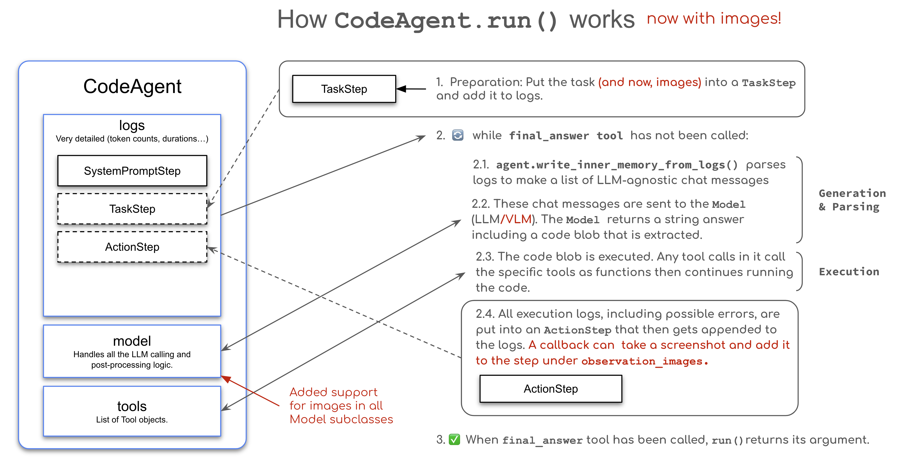

# 16 · Vision & Browser Agents { #week-4-vision-browser }

**Objective:** build an agent that reads an image and another that checks a webpage using screenshots.

**Before starting:** finish [Week 4 setup](week-4-preview.md#exercise-files), including [creating `evidence.md` and `evidence-files`](week-4-preview.md#evidence-file). Use the same activated terminal in `week04-exercises`. Chrome is required for the browser sections.

| Item | Status / action |
| --- | --- |
| `week04_common.py`, `week04_browser.py`, `prepare_visuals.py` | Supplied in the ZIP; open the existing files when asked. |
| `assets/venue.png`, `assets/venue.html` | Generated by running the supplied `prepare_visuals.py` during setup. If they are missing, run that program before starting A. |
| `my_vision.py`, `my_browser_check.py`, `my_browser.py` | Not supplied. Create each separately below. |
| `before.png`, `after.png` | Generated by the direct browser check; absent until that program succeeds. |
| `outputs/browser-*.png` | Generated by the browser-agent callback; absent until that agent runs. |
| `evidence.md`, `evidence-files` | Created by you during setup. Reopen the existing note and use the folder to preserve results. |

Read your agent’s answers in the terminal. Use an image viewer to check the venue plan and saved screenshots; the browser exercises open a separate Chrome window.

## Where and when to run { #where-and-when }

**Write and save Python in your code editor. Run the commands in your terminal:** **Command Prompt on Windows** or **Terminal on Mac**, using the activated Week 4 environment. The terminal's current folder must be **`week04-exercises`**, where `requirements.txt`, the supplied helpers and your `my_*.py` files are together. Look for **`(.venv)`** in the prompt. If you opened a fresh terminal, follow [the Week 4 folder and activation instructions](week-4-preview.md#activate-environment) before continuing.

Type only the command shown in each **Run** block, then press **Enter**. Do not type it into a Python `>>>` prompt, the course webpage or Chrome's developer console. Wait for the program to finish and the terminal prompt to return before the next command.

| Stage | When to run | Command |
| --- | --- | --- |
| Before A | Only if the venue assets are missing, before making any page edits. | `python prepare_visuals.py` |
| B · Initial image | After B1–B3 are assembled in `my_vision.py`, saved, and your predictions are recorded. | `python my_vision.py` |
| B · Changed question | After preserving the first answer, changing the task question and saving the same file. | `python my_vision.py` |
| C · Direct browser check | After `my_browser_check.py` is created and saved. Complete this successfully before D. | `python my_browser_check.py` |
| D · Browser agent | After D1–D3 are assembled in `my_browser.py`, saved, and C has succeeded. | `python my_browser.py` |
| D · Changed page | After archiving the baseline screenshots, editing and saving `assets/venue.html`, and recording your prediction. | `python my_browser.py` |

All commands above run from the **same activated `week04-exercises` terminal**. In A, inspect the image without running Python. Finish B1–B3 before running `my_vision.py`, and D1–D3 before running `my_browser.py`. The program opens and controls its own Chrome window in C and D; you do not need to open the HTML page manually first.

You will use a fictional venue plan. The image contains room labels; the browser page reveals additional access information only after a click. Search snippets and fetched page text are different from seeing and interacting with a rendered page.

## How image observations enter the agent loop { #vision-memory }

A vision-language model receives pixels as well as text. Passing `images=[image]` at the start attaches task input. In browser work, the important information may appear only after an action; the agent needs a new screenshot in a later observation before it can reason about the changed page.

[](images/huggingface-week04/vision-memory.png){ .course-figure-link }

[Open the full-size original](images/huggingface-week04/vision-memory.png)

*Original figure, unchanged: [HF Vision and Browser Agents](https://huggingface.co/learn/agents-course/en/unit2/smolagents/vision_agents). Follow the task image into the task step, then the screenshot into an action step.*

Follow the image through the diagram: first as task input, then as an observation after an action. The callback captures the screenshot; the model decides what to do next. In the code you will use, screenshots are attached to `ActionStep.observations_images`, and the agent’s history is stored in `agent.memory.steps`.

**Before coding:** draw one loop for the initial image and a second loop for the browser. Mark where new pixels enter. Predict what would go wrong if the callback saved a PNG file but never attached it to the step. After the browser run, show the action, saved screenshot, and next answer that used it.

??? success "Reasoning check"

    Saving a file is not the same as delivering an image to the model. The screenshot must be included in the observation sent on a later call. Without that new observation the agent may reason from old pixels or guess what changed.

For another example, watch the optional [HF browser demonstration](https://www.youtube.com/watch?v=rObJel7-OLc). Pause after an action and look for the next screenshot. The exercises below use the venue plan from your download.

## A. Predict from the image { #predict }

In File Explorer/Finder, open **`week04-exercises` → `assets` → `venue.png`**. This image already exists **after setup's generator run**; do not create an empty file with that name. If it is missing, follow the setup link above.

Under **Topic 16 → Image predictions** in your existing `evidence.md`, answer these before calling a model:

**1. List three visible facts and one question the image cannot answer.**

??? success "Image answer 1 — visible facts and a missing fact"

    Examples: the image labels an ENTRANCE at the upper left, a STAGE at the upper right, and a BUFFET at the lower left. EXIT is labeled at the lower right. It does not establish whether the exit is open now. Choose any three actual visible facts and identify a genuinely missing fact.

**2. Is the exit open?**

??? success "Image answer 2 — exit availability"

    The picture labels an exit but shows no current closure/open-status information. “There is a labeled exit” is supported; “the exit is open” is not established by these pixels.

**3. Does a colored rectangle establish an accessible route?**

??? success "Image answer 3 — accessibility"

    No. Colors and room positions do not establish step-free paths, door widths or current access conditions. The model should separate the visible layout from information that needs another source.

Save your predictions. The supplied asset generator uses no LLM; the next program does.

## B. Build the image agent { #initial-image }

Create **`my_vision.py`** in your code editor, directly inside **`week04-exercises`**, beside `week04_common.py`. Use **New Text File → Save As**; it is not supplied. Save with **Ctrl + S** or **Command + S**, with a `.py` extension. If you already have this file, save a copy before replacing its contents.

Add the blocks in **B1 → B2 → B3** to this same file, in order. Save it after each part, and run it only after B3.

**What this file does — `my_vision.py`:** uses a Groq vision-capable model to inspect the generated venue plan. It has no custom search/browser tools. The answer appears in the terminal, where you compare it with the image you opened.

### B1. Load the input { #b1-load-the-input }

Paste this first block to open `assets/venue.png` as an image.

```python title="my_vision.py"
from pathlib import Path
from PIL import Image
from smolagents import CodeAgent
from week04_common import build_model, agent_options, run_task

root = Path(__file__).resolve().parent
image = Image.open(root / "assets/venue.png").convert("RGB")
```

??? info "Explain B1 — the image object"

    `root` locates your saved script's folder. Pillow reads the existing generated PNG and converts its color mode. This neither creates an agent nor sends pixels to Groq. A filename alone is not the image input.

### B2. Create the image agent { #b2-create-the-image-agent }

Add this block below B1. Compare `tools=[]` with the web specialist’s tool list from Topic 15. What can this agent do without a search tool? Write your answer in `evidence.md`.

```python title="my_vision.py"

agent = CodeAgent(
    tools=[],
    model=build_model(),
    **agent_options(max_steps=3),
)
```

??? info "Explain B2 — create the image agent"

    You create a new `CodeAgent` object here. `tools=[]` provides no custom search or browser tools; the built-in final-answer tool is still available. `model=build_model()` connects the agent to Groq, and `max_steps=3` limits its action steps. Image input is attached in the next stage, not by adding a search tool.

### B3. Give your agent the pixels and a task { #b3-give-your-agent-the-pixels-and-a-task }

Append this last block, then save the same file. Before running, predict one supported label and one unavailable fact.

```python title="my_vision.py"

run_task(agent,
    "Inspect this fictional venue plan. Name the labeled areas and their relative positions. Separate visible facts from assumptions. Can the image prove whether the exit is currently open? State uncertainty.",
    images=[image],
)
```

??? info "Explain B3 — send pixels, not a path"

    `run_task` starts execution. `images=[image]` attaches actual pixels to this task; a path written in the question would not attach them. Compare the model's answer with your own prediction rather than assuming it interpreted the image correctly.

**Build check:** which stage creates an agent, which supplies pixels, and why is the search tool absent?

??? success "Vision build answer"

    **B2 creates the agent; B3 attaches pixels and starts it.** The agent can describe the image you pass in B3 without searching the web. B1 only loads the input. Empty custom tools do not mean there is no LLM.

**When:** after completing and saving **all three blocks B1–B3**, your build-check answer and image predictions. **Where:** in the activated terminal, with its current folder set to **`week04-exercises`**.

**Run:**

```bash
python my_vision.py
```

Enter the Groq key if prompted. Wait for the final result and terminal prompt. **What to check:** compare each reported label/position with the open image. In the existing `evidence.md`, paste one supported statement and one uncertain or unsupported statement. This program prints text; it does not generate a new image file.

**Try a different question:** first copy the original task sentence and its result into your note. In the **existing `my_vision.py`**, replace only the complete `run_task(...)` call at the bottom with the exact block below. Keep the imports, image loading and agent creation above it unchanged. Save the change in the same file.

**What this replacement does:** the same Groq vision agent receives the same image with a question about a step-free route; its answer is printed in the terminal.

```python title="Replace only the run_task call in existing my_vision.py"
run_task(agent,
    "Describe a step-free route from ENTRANCE to BUFFET. Separate visible layout from missing accessibility information.",
    images=[image],
)
```

??? info "Explain the change"

    Only the task text changes. The image is still attached with `images=[image]`, and the same agent/model is used. This lets you compare a new question against the same visible evidence.

**When:** after copying the first task/result into `evidence.md`, replacing only the task call above and **saving `my_vision.py` again**. **Where:** the same activated terminal in **`week04-exercises`**.

**Run again:**

```bash
python my_vision.py
```

Wait for the result, then record the changed question and actual answer in your existing `evidence.md`.

**4. Does the image contain enough information for a verified step-free route, and what observation is missing?**

??? success "Image answer 4 — changed prompt"

    No. It shows relative areas but no verified ramps, thresholds, widths or passage conditions. Describe the relative positions, then state which accessibility details are missing. The next browser section adds a written access instruction, which is a new observation—not independent physical inspection of a route.

**Checkpoint:** save both task/result comparisons and your four answers in the existing `evidence.md`. Keep `my_vision.py` saved; no second vision program is needed.

## C. Test a real browser action without an LLM { #browser-check }

1. In your code editor, open **`week04-exercises`**, with `requirements.txt` and `week04_common.py` visible.
2. Choose **File → New Text File → Save As** and save **`my_browser_check.py`** directly beside them. **This file is not in the ZIP; create it now.**
3. Paste the complete code below.
4. Save with **Ctrl + S** (Windows) or **Command + S** (Mac). The name must end in `.py`, not `.py.txt`; do not save inside `.venv`, `lessons` or `assets`.

**What this file does — `my_browser_check.py`:** Opens the local venue page in a separate Chrome window, clicks its details button, and saves `before.png` and `after.png`. It uses Selenium, not an LLM. Open the two screenshots to check the changed observation.

```python title="my_browser_check.py"
from week04_browser import BrowserSession

browser = BrowserSession()
try:
    print(browser.tools[0]())
    browser.driver.save_screenshot("before.png")
    print(browser.tools[1]())
    browser.driver.save_screenshot("after.png")
    print("Compare before.png and after.png")
finally:
    browser.close()
```

??? info "Explain the code"

    | Code | What it means |
    | --- | --- |
    | `BrowserSession()` | Start a separate Chrome session using the supplied helper. It may obtain a compatible driver. No LLM is used. |
    | `browser.tools[0]()` | Call the supplied `open_venue` tool directly; it opens the generated local HTML file. |
    | The first `save_screenshot` | Generate `before.png` in the current terminal folder. |
    | `browser.tools[1]()` | Call `show_access_details`, which clicks the local page button. |
    | The second `save_screenshot` | Generate `after.png` after the click. |
    | `finally: browser.close()` | Close the separate Chrome session even if a later step fails. |

    The Chrome window may close quickly; inspect the saved PNGs afterwards. This direct test establishes the browser/tool setup before adding a model. Tool success strings are not a substitute for the images.

**When:** after creating `my_browser_check.py`, pasting the **whole block** and saving it; the generated `assets/venue.html` must already exist. Run this direct check **before building/running the browser agent in D**. **Where:** the activated terminal in **`week04-exercises`**.

**Run:**

```bash
python my_browser_check.py
```

The program opens Chrome, performs the click, saves the screenshots and closes Chrome automatically. Wait for the terminal prompt to return. If Chrome or its driver fails, resolve this direct check before the agent run.

**What to check:** after Chrome closes, open **`before.png`** and **`after.png`** directly inside `week04-exercises` in File Explorer/Finder. These are **generated screenshots**, not files you create or download. If absent, inspect the terminal error. Rerunning this check replaces same-name screenshots.

**1. What changed after the click?**

??? success "Browser answer 1 — changed observation"

    `before.png` shows the venue and button without the access paragraph. `after.png` should show “The east exit is closed for maintenance” and “Use the north entrance for accessible entry.” Read your actual screenshots; if that text is not visible, do not claim the check passed.

**2. What does this direct test prove, and what does it not prove?**

??? success "Browser answer 2 — direct-test scope"

    It shows that the local page loaded, the supplied click operated and the screenshot changed. It uses no model, so it cannot demonstrate a model choosing the click or receiving/understanding pixels.

In the existing `evidence.md`, record both screenshot names, the changed text and your two answers. Keep the PNGs in place for review; do not paste HTML source as a substitute for the screenshots.

## D. Build the browser agent { #browser-loop }

Create **`my_browser.py`** directly in **`week04-exercises`**, beside the other scripts. This file is not supplied. Add D1, D2 and D3 to the same file in that order, then save it. If you are replacing an earlier version, save a copy of your work first.

This agent will open the local page, click its details button and use the new screenshot to answer a question. The screenshot callback connects each browser action to the image the model receives next.

**What this file does — `my_browser.py`:** uses Groq to choose actions on the local page and receive fresh screenshots after them. Selenium tools operate Chrome; `outputs/browser-*.png` stores observations. Inspect the terminal trace, image sequence and final answer.

### D1. Import the parts { #d1-import-the-parts }

```python title="my_browser.py"
from smolagents import CodeAgent
from week04_common import build_model, agent_options, run_task
from week04_browser import BrowserSession
```

??? info "Explain D1 — tools and screenshots"

    `BrowserSession` supplies tools and a screenshot callback. Importing it does not create a model agent. You create the `CodeAgent` in the next block.

### D2. Define the browser agent { #d2-define-the-browser-agent }

Add this function below D1. It creates the agent with browser tools and a screenshot callback. You will call the function in D3.

```python title="my_browser.py"

def build_browser_agent(model, browser):
    return CodeAgent(
        tools=browser.tools,
        model=model,
        step_callbacks=[browser.capture],
        **agent_options(max_steps=6),
    )
```

??? info "Explain D2 — receive screenshots after actions"

    `tools=browser.tools` registers opening/clicking actions. `step_callbacks=[browser.capture]` captures and attaches pixels after each step. The supplied callback writes PNGs to `outputs`, sets `ActionStep.observations_images`, records the URL and removes older images from history. Saving a PNG without attaching it would not send it to the model. The callback supplies observations; the agent chooses actions.

### D3. Open the browser and add the task { #d3-open-the-browser-and-add-the-task }

Append this final block. Keep the `try` body indented as shown and `finally` aligned with `try`. `finally` ensures that Chrome closes when the program finishes or an error occurs. Save before running.

```python title="my_browser.py"

browser = BrowserSession()
try:
    agent = build_browser_agent(build_model(), browser)
    run_task(agent, """Use open_venue first, then inspect its screenshot.
In a separate action step call show_access_details. Inspect the NEW screenshot
before answering: which exit is closed and which entrance is recommended?
Describe the visual evidence and explain what the original venue plan alone
could not establish. Do not combine both tool calls in one action step.
""")
finally:
    browser.close()
```

??? info "Explain D3 — construction, execution and cleanup"

    The session starts Chrome. Calling `build_browser_agent` constructs your new agent using that session; `run_task` starts its decisions. The task requires a later click so the model can compare two states. `finally` closes Chrome on success or error. Numbered PNGs are generated during execution; `browser-*.png` is a filename pattern, not a file you create.

**Build check:** compare this agent with B2. Which two settings connect actions and fresh observations, and what would happen if the callback were absent?

??? success "Browser build answer"

    `tools=browser.tools` enables actions; `step_callbacks=[browser.capture]` supplies fresh pixels after them. Without the callback this program would not deliver the new screenshot through its observation loop, so a click-success message alone would not establish what became visible.

**When:** after C has succeeded, **all three blocks D1–D3** are assembled and saved in `my_browser.py`, and you have answered the build check. **Where:** the activated terminal in **`week04-exercises`**.

**Run:**

```bash
python my_browser.py
```

Enter the Groq key if prompted. Let the program control its Chrome window and wait for the final result and terminal prompt. **What to check:** find separate `open_venue` and `show_access_details` calls in the terminal, then open the generated numbered PNGs inside **`week04-exercises/outputs`** and match the images to the actions. There may be more than two PNGs because the callback also runs after other steps. Use the actual filenames, not an assumed count.

**1. Which exit is closed and which entrance is recommended? What supports the answer?**

??? success "Agent answer 1 — baseline evidence"

    After the click, the screenshot text says the east exit is closed and recommends the north entrance. The earlier room-label image alone did not establish this. The answer must follow a screenshot returned after the click, not just the tool's “Clicked” message.

**2. What if both tools ran in one action step?**

??? success "Agent answer 2 — separate states"

    One end-of-step capture may show only the final page. Record that you only received the final state. Check that the task in D3 is copied in full: it asks for the two tools to run in separate steps. To compare before and after, you need a screenshot after each action.

**3. What is the callback responsible for?**

??? success "Agent answer 3 — observation versus decision"

    The agent/model chooses the action. The callback captures current pixels and attaches them to the step for a later model call. It does not choose the click or guarantee correct interpretation. Initial `images=[image]` supplies a task image; the callback supplies a new observation after execution.

### Preserve the baseline and change the practice page { #browser-comparison }

**Preserve these generated results before the next run:**

1. Open the **existing `evidence-files` folder** from setup. Create a new folder inside it named **`browser-baseline`**, using **New Folder** in your file manager. You create this archive folder manually; it is not generated by Python.
2. Copy the actual `outputs/browser-*.png` files into that folder. In the existing `evidence.md`, paste the baseline action/answer excerpt and list the relevant screenshot names.
3. In your code editor, open the **existing generated `assets/venue.html`**. Do not create a new HTML file or edit a lesson page. Find this exact text in its access-details paragraph:

```text
The east exit is closed for maintenance. Use the north entrance for accessible entry.
```

4. Replace only those two sentences with the following fictional test data. Leave the HTML tags and button unchanged:

```text
The west exit is closed for maintenance. Use the south entrance for accessible entry.
```

5. Save `assets/venue.html`. In `evidence.md`, predict the new answer. **Do not rerun `prepare_visuals.py`**, which would restore the original text.
6. **Only after steps 1–5 are complete**, return to the **same activated terminal in `week04-exercises`** and run **`python my_browser.py`** again. The helper starts a new Chrome session and opens your saved local page. Wait for the final result and terminal prompt before step 7. Keep `my_browser.py` unchanged so you can test whether the answer follows the edited page.
7. Create **`browser-revised`** inside the existing `evidence-files` folder and copy the new `outputs/browser-*.png` files there. The callback starts numbering again for each session, so the original outputs may be replaced; use the two archive folders for comparison.

**4. Does the new answer follow the changed screenshot?**

??? success "Agent answer 4 — changed-page comparison"

    After the saved edit and a fresh run, the newly revealed paragraph should identify the **west** exit and **south** entrance. Compare it with the archived east/north baseline. An east/north answer against west/south pixels is unsupported. If it occurs, record it and inspect whether the file was saved, the correct page opened and a fresh screenshot reached the agent.

**5. What uncertainty remains even when the answer matches the page?**

??? success "Agent answer 5 — remaining limit"

    The screenshot supports what this fictional page says, not an independently verified physical route. It does not establish actual access conditions, and the model can still misread it.

**Checkpoint:** save the three Python files, your existing `evidence.md`, direct `before.png`/`after.png`, and both archived agent-run screenshot folders. Keep `assets/venue.html` with your edit, and record the exact two-sentence change. You can restore the original text in that same file after saving the evidence; do not erase the comparison.

## Troubleshooting and credit { #credit }

If the generated image/page is missing, run the **supplied** `python prepare_visuals.py` in the **activated terminal with `week04-exercises` as its current folder**, before returning to A. That replaces existing assets, so first save any page edit you want to preserve in your evidence note. For Chrome errors, confirm Chrome is installed and allow Selenium Manager to obtain its compatible driver; institutional network restrictions may need instructor help. For image-request errors or model limits, check model access and keep only the latest screenshot. A text-only response without an image reaching the model is not a completed vision run.

| Problem | What to check |
| --- | --- |
| `No such file` for a `my_*.py` program | Create that named file using the lesson steps; check its save location and `.py` extension. |
| Import error for a `week04_...` helper | Check the extracted root and supplied files; use the environment where `requirements.txt` was installed. |
| Missing `before.png` / `after.png` | The direct check has not succeeded, or the terminal was in another folder. Inspect its error and current folder. |
| Missing `outputs` folder | No successful report/capture has created it yet. Do not create empty replacement results. |
| Revised run still displays original text | Check the saved `assets/venue.html`, not a second copy, and whether you reran the generator. Compare a fresh screenshot. |

**Credits:** [HF Vision and Browser Agents](https://huggingface.co/learn/agents-course/en/unit2/smolagents/vision_agents), Apache-2.0, inspired the initial-image and screenshot-observation structure. This course supplies original venue assets and bounded Selenium tools. The model is documented in [Groq image-input guidance](https://console.groq.com/docs/vision); check your model access if an image request is rejected.

**Next:** [17 · Completion checks](week-4-completion.md).
