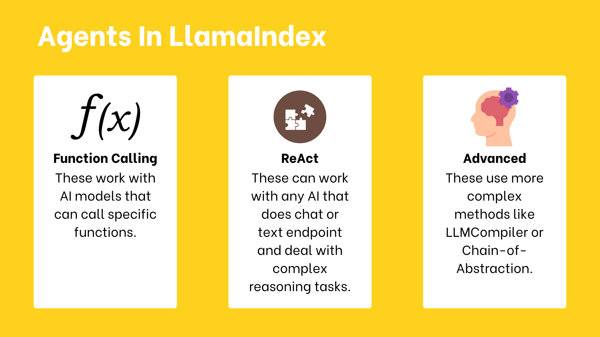
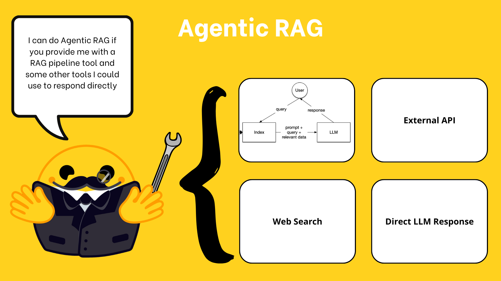

# 22 · Let an agent choose tools { #week-5-agents }

**Goal:** observe the difference between a direct tool call and a model choosing an action. Complete [Quiz 1](week-5-quiz-1.md). Use the same activated `week05-exercises` terminal.

## 1. Choose the kind of agent { #agent-types }

HF introduces **function-calling agents**, which use a model’s structured tool-call interface; **ReAct agents**, which interpret a text reasoning/action format; and **custom agents**, which define more specialized behaviour. We use the function-calling route with the classroom model. In `AgentWorkflow.from_tools_or_functions`, the framework chooses its supported agent route from the model’s metadata.

[](images/huggingface-week05/agents.png){ .course-figure-link }

*HF original figure, unchanged. [Source lesson](https://huggingface.co/learn/agents-course/en/unit2/llama-index/agents) · [Enlarge the figure](images/huggingface-week05/agents.png).*

**Read the figure:** these are different ways to build the decision loop. Function calling asks the model for a structured tool name and inputs. ReAct uses a text action format that the framework must interpret. Custom agents define their own behavior. A model still needs to follow the chosen format reliably.

**Our route:** use function calling. For “2 times 2,” the model chooses `multiply` and supplies `a=2, b=2`; Python computes `4`; the model then answers. Check each part in the printed trace.

An agent can choose the wrong tool or use it with wrong inputs. A final answer alone does not prove that a tool ran. The helper prints **REQUEST**, actual **TOOL** calls, their **RETURN** values and the final **ANSWER**. Inspect those observations; the lesson does not require exposing a model’s private reasoning.

## 2. Start with one arithmetic tool { #arithmetic }

**Create `my_agent.py`.** It gives an agent a multiplication function, asks HF’s “2 times 2” question, and prints the tool trace and answer. Groq chooses an action; Python performs the arithmetic. This uses Groq tokens and prints in the terminal.

```python title="my_agent.py"
from llama_index.core.agent.workflow import AgentWorkflow
from week05_common import get_llm, run, show_agent


def multiply(a: int, b: int) -> int:
    """Multiply two integers and return the result."""
    return a * b


async def main():
    agent = AgentWorkflow.from_tools_or_functions(
        tools_or_functions=[multiply], llm=get_llm(),
        system_prompt="Use the multiply tool for multiplication. State its returned result.",
        timeout=180,
    )
    await show_agent(agent, "What is 2 times 2? Use the tool.")

if __name__ == "__main__":
    run(main)
```

??? info "Explain the agent"

    The function’s signature/docstring become a tool interface. `AgentWorkflow.from_tools_or_functions` combines the tools, model and instructions. `show_agent` starts the workflow and prints completed tool calls. The iteration cap and timeout bound the attempt. The main guard allows other programs to import `multiply` without running this task.

**Run:** `python my_agent.py`.

Find a `multiply` call with `a=2`, `b=2`, a return value of `4`, and an answer consistent with it. If no tool call appears, mark the tool-use check incomplete even if the answer is `4`. Compare the trace with `weather.call(...)` in the previous lesson: who selected the operation in each case?

## 3. Keep memory with Context { #memory }

**Create `my_memory.py`.** It tells the agent “My name is Bob,” asks the name again using the same context, then repeats the question with a fresh context. Inputs are these three messages; the comparison appears in the terminal. All three interactions use Groq tokens.

```python title="my_memory.py"
from llama_index.core.agent.workflow import AgentWorkflow
from llama_index.core.workflow import Context
from my_agent import multiply
from week05_common import get_llm, run, show_agent

async def main():
    agent = AgentWorkflow.from_tools_or_functions(
        tools_or_functions=[multiply], llm=get_llm(), timeout=180,
        system_prompt="Answer briefly. Remember only information present in this conversation.",
    )
    ctx = Context(agent)
    await show_agent(agent, "My name is Bob.", ctx=ctx)
    await show_agent(agent, "What was my name again?", ctx=ctx)
    print("NOW A FRESH CONTEXT:")
    await show_agent(agent, "What was my name again?", ctx=Context(agent))

if __name__ == "__main__":
    run(main)
```

??? info "Explain memory"

    `Context(agent)` stores information for the workflow run history. Passing the same `ctx` connects the first two interactions. The supplied `show_agent` helper explicitly carries the existing conversation memory into each next run so the earlier messages are retained. A new context does not receive the earlier name. The same model object does not by itself mean the conversation history is shared. This example does not save memory across program restarts.

**Predict:** which question has the earlier name available? **Run:** `python my_memory.py` once.

Check the three answers:

1. The first acknowledges Bob; the exact greeting may vary.
2. The same context remembers Bob.
3. The fresh context says the name is unknown.

**If you see `UnserializableKeyWarning`:** the framework cannot serialize its memory object automatically. Our helper carries that object into the next run. Judge this exercise by the answers above. If the second answer forgets Bob, run `python week05_common.py` and check for version **2026-11-10.2**. If yours differs, replace only that helper from the current ZIP and rerun this exercise. Keep your other work.

??? info "How the final answer is displayed"

    Some model replies contain `<think>` tags or repeat text around `</think>`. The helper shows the final text after those tags and omits tagged thinking text. This cleans presentation; the tool/source checks still determine whether the answer is supported.

Record the three results in section 22 of `evidence.md`. A new program run resets the example; keep the supplied Bob messages unchanged.

## 4. Give the agent a RAG tool { #rag-agent }

[](images/huggingface-week05/agentic-rag.png){ .course-figure-link }

*HF original figure, unchanged. [Source lesson](https://huggingface.co/learn/agents-course/en/unit2/llama-index/agents) · [Enlarge the figure](images/huggingface-week05/agentic-rag.png).*

**Read the figure:** the agent has several possible actions. Document search is one of those actions. It can choose a tool, read its result, then decide how to answer.

**In our project:** only `personas` and `multiply` are available; the picture’s web search and external API are broader examples. A persona question should use `personas`. A multiplication question should use `multiply`. Check the selected tool and its return before trusting the final answer.

**Create `my_rag_agent.py`.** It gives an agent both multiplication and the persona query tool. The request asks it to search the persona descriptions and return evidence. The query engine and the agent both use Groq; one tool call can therefore involve several model requests. Read the tool trace and final answer in the terminal.

```python title="my_rag_agent.py"
from llama_index.core.agent.workflow import AgentWorkflow
from my_agent import multiply
from week05_common import get_llm, run, show_agent
from week05_rag import persona_tool

async def main():
    llm = get_llm()
    agent = AgentWorkflow.from_tools_or_functions(
        tools_or_functions=[multiply, persona_tool(llm)], llm=llm, timeout=180,
        system_prompt=("Use personas for questions about profiles and multiply for arithmetic. "
                       "Quote only original EXCERPT text, cite its SOURCE filename, and distinguish it from GENERATED ANSWER text. "
                       "Search results cover only retrieved passages. Say no match was found in those passages; do not claim all profiles were checked. Do not invent names or contact details."),
    )
    await show_agent(agent, "Find the persona interested in Cincinnati art. Use personas and quote its description.")

if __name__ == "__main__":
    run(main)
```

??? info "Explain agentic RAG"

    A fixed query engine always follows its retrieval-and-answer path. This agent has a choice between tools and can decide what query to send to `personas`. The returned query-engine answer is an observation for the agent, which may then compose another answer. Inspect both outputs for unsupported additions. `return_direct=False` allows the agent to use the tool result rather than immediately treating it as the final answer.

**Run:** `python my_rag_agent.py`.

Check the result in this order:

1. Find `TOOL: personas` and its returned **SOURCE** and **EXCERPT**.
2. Open that source file in `data` and compare its text with the excerpt.
3. Check that the final quotation matches the original text and cites the filename.

The separately labeled **GENERATED ANSWER** is a model summary. If the tool call, original text or citation is missing, record what is incomplete.

**Compare tool selection in `my_rag_agent.py`:** find the `await show_agent(...)` line **inside `main`**. Leave the bottom `run(main)` line alone. Replace the whole request line with this, keeping four leading spaces:

```text
    await show_agent(agent, "What is 2 times 2? Use multiply.")
```

Save and run `python my_rag_agent.py` once. Look for `TOOL: multiply` and `RETURN: 4` rather than a persona lookup. Save the trace in `evidence.md`, then restore and save this exact original line:

```text
    await show_agent(agent, "Find the persona interested in Cincinnati art. Use personas and quote its description.")
```

??? info "Optional: search for a different interest"

    **Optional HF comparison, if capacity allows:** save the original request line in `evidence.md`. In that same place inside `main`, use this complete line:

    ```text
        await show_agent(agent, "Search the database for 'science fiction' and return some persona descriptions. Use only the source excerpts. If they contain no match, say no match was found in the retrieved passages; do not claim to have checked every profile.")
    ```

    Run `python my_rag_agent.py` once. The tool retrieves at most two passages from ten files. “No match in these passages” is supported if neither mentions science fiction. “No persona in the database likes science fiction” is too broad: the other files were not all checked. Record which claim the answer makes, then restore the original request line shown above.

## 5. Connect two agents { #team }

HF next creates a calculator and an information-lookup agent. Each has its own tools and instructions. An `AgentWorkflow` has a **root agent** that receives the user message first. A handoff transfers the active role to another agent; the diagram alone does not prove a handoff took place.

**Create `my_agent_team.py`.** It starts with the calculator, then asks for persona research that belongs to `info_lookup`. This uses the existing index, a shared Groq connection and model tokens. Inspect the terminal for the handoff and the persona search, not just the final answer.

```python title="my_agent_team.py"
from llama_index.core.agent.workflow import AgentWorkflow, FunctionAgent
from my_agent import multiply
from week05_common import get_llm, run, show_agent
from week05_rag import persona_tool

async def main():
    llm = get_llm()
    calculator = FunctionAgent(
        name="calculator", description="Multiplies integers.",
        system_prompt="Use multiply for math. Hand persona research to info_lookup.",
        tools=[multiply], llm=llm, can_handoff_to=["info_lookup"],
    )
    researcher = FunctionAgent(
        name="info_lookup", description="Searches ten persona descriptions.",
        system_prompt="Use personas. Quote only original EXCERPT text and cite its SOURCE filename. GENERATED ANSWER is not a source quotation. Limit missing-match claims to the retrieved passages. Mark missing information.",
        tools=[persona_tool(llm)], llm=llm, can_handoff_to=["calculator"],
    )
    team = AgentWorkflow(agents=[calculator, researcher], root_agent="calculator", timeout=180)
    await show_agent(team, "Find the Cincinnati art historian. Hand this task to info_lookup, which must query personas.")

if __name__ == "__main__":
    run(main)
```

??? info "Explain the team"

    Two distinct `FunctionAgent` objects have different names, tools and prompts. `can_handoff_to` specifies the permitted destinations. `root_agent="calculator"` selects the entry point. Both receive the same model connection, but remain separate roles. The handoff tool should appear in the trace before `personas`. The plain arithmetic task from HF can be handled by the calculator alone; this research request deliberately exercises the connection.

**Run:** `python my_agent_team.py`. Find the handoff to `info_lookup`, its `personas` call, a returned passage and an answer that preserves it. Record the observed handoff and result in section 22.

**Checkpoint:** save a trace excerpt for arithmetic, the Bob comparison, the RAG tool choice and the handoff. Explain why two agents using one model connection are still two agents.

*Source and adapted examples: [HF Unit 2.2 — agents](https://huggingface.co/learn/agents-course/en/unit2/llama-index/agents). Apache-2.0; see the starter’s `NOTICE.md` and `HF-LICENSE.txt`.*

## Stop and check { #checkpoint }

| New file to keep | Result to confirm |
| --- | --- |
| `my_agent.py` | `multiply(2,2)` actually ran and returned `4`. |
| `my_memory.py` | The shared context remembers Bob; a fresh context has no evidence of the name. |
| `my_rag_agent.py` | A persona call, original source excerpt, and a correctly attributed quotation or honest missing evidence. Restore its original request after comparisons. |
| `my_agent_team.py` | A real handoff to `info_lookup`, followed by its persona call. |

Keep `my_agent.py`: the other agent examples import its multiplication function. Save traces in section 22 of your note.

**Next:** [23 · Workflows](week-5-workflows.md).
