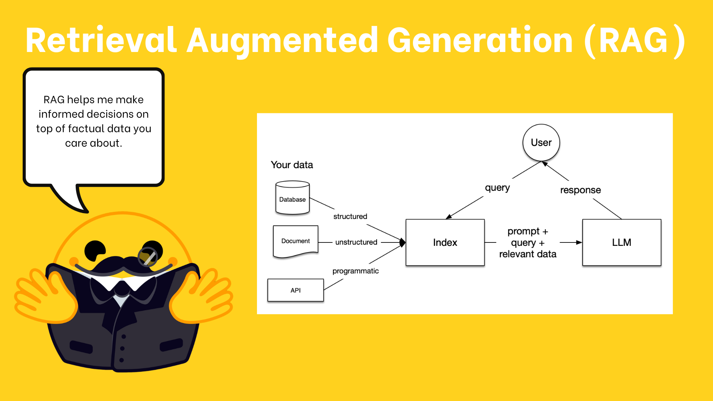

# 20 · Build a document question-answer system { #week-5-components }

**Goal:** follow the same data through loading, indexing, storing, querying and evaluation. Use the ten persona files created in [setup](week-5-learning-plan.md#environment).

[](images/huggingface-week05/rag.png){ .course-figure-link }

*HF original figure, unchanged. [Source lesson](https://huggingface.co/learn/agents-course/en/unit2/llama-index/components) · [Enlarge the figure](images/huggingface-week05/rag.png).*

**Read the figure:** start at “Your data” on the left. The index makes that data searchable. A question selects relevant text, which is added to the model request. The model writes an answer from the question and that text.

**In our project:** “Your data” is ten persona files. Asking about Cincinnati should retrieve `persona_0.txt`. Retrieval finds the passage; Groq writes the answer. You still compare the answer with the original passage, because a generated answer can contain mistakes.

## 1. Understand the five stages { #stages }

| Stage | What happens | What to inspect |
| --- | --- | --- |
| Loading | Read text files into `Document` objects. | File names and document count. |
| Indexing | Split documents into `Node` chunks and embed their text. | Chunk count and settings. |
| Storing | Save vectors and metadata in Chroma. | The generated `alfred_chroma_db` folder. |
| Querying | Retrieve similar chunks, then optionally generate an answer. | Retrieved text, source names and answer. |
| Evaluation | Check whether the answer is supported and useful. | Source comparison and any evaluator feedback. |

A `Node` is a chunk linked to its source document. Store the vectors rather than re-embedding every time you ask a question. Use the same embedding model for documents and questions so their vectors can be compared.

## 2. Load, split, embed and store { #ingest }

**Create `my_ingest.py`.** It reads the ten local text files, splits them, computes embeddings on your CPU and saves them in a Chroma database. It uses no generative LLM and no Groq tokens. The first embedding run needs internet to download the model; counts and the saved folder are visible in the terminal/file manager.

```python title="my_ingest.py"
from llama_index.core import SimpleDirectoryReader
from llama_index.core.ingestion import IngestionPipeline
from llama_index.core.node_parser import SentenceSplitter
from week05_common import ROOT, run
from week05_rag import embedding_model, get_store

async def main():
    files = [ROOT / "data" / f"persona_{number}.txt" for number in range(10)]
    missing = [path.name for path in files if not path.is_file()]
    if missing:
        raise FileNotFoundError(
            "Missing persona files: " + ", ".join(missing)
            + ". Run python prepare_personas.py; see setup troubleshooting if data is incomplete."
        )
    documents = SimpleDirectoryReader(
        input_files=[str(path) for path in files], filename_as_id=True,
    ).load_data()
    print("Documents:", len(documents))
    if len(documents) != 10:
        raise ValueError("Use the ten supplied-dataset persona files for this first run.")
    collection, vector_store = get_store()
    if collection.count():
        if collection.count() < len(documents):
            raise ValueError("The saved index is incomplete. Close its programs, rename alfred_chroma_db as a backup, then rerun my_ingest.py.")
        print("Index already exists. Reuse it; no documents were added.")
        return
    pipeline = IngestionPipeline(
        transformations=[
            SentenceSplitter(chunk_size=256, chunk_overlap=20),
            embedding_model(),
        ],
        vector_store=vector_store,
    )
    nodes = await pipeline.arun(documents=documents)
    print("Indexed chunks:", len(nodes))
    print("Stored vectors:", collection.count())
    print("Saved in alfred_chroma_db/")

if __name__ == "__main__":
    run(main)
```

??? info "Explain the pipeline"

    `files` names the ten intended persona files explicitly. A missing file produces a message telling you what to download. `SimpleDirectoryReader` reads that list and preserves each filename as metadata, including when an ancestor folder is hidden. `SentenceSplitter` uses a 256-token target with a 20-token overlap; the documents are short, so a document may fit in one chunk. The embedding transformation uses `BAAI/bge-small-en-v1.5`. `get_store()` returns a local Chroma collection named `alfred` and its LlamaIndex adapter. `pipeline.arun` performs the transformations and stores the nodes. An existing non-empty collection is reused, preventing duplicate ingestion on a simple rerun.

**Save and run:** `python my_ingest.py`.

Check **`Documents: 10`**, a positive chunk/vector count, and `alfred_chroma_db` beside your script. Do not expect a model answer yet. Run the same file again: it should say the index already exists. The stored count should not grow.

If you later change the data or embedding settings, the old database does not update automatically. Preserve your evidence, close all programs using it, rename the generated `alfred_chroma_db` folder as a backup, and rerun ingestion to create a fresh database. Keep the original ten-file dataset unchanged for the first exercise. If indexing was interrupted, use this same fresh-database procedure rather than trusting a partial index.

## 3. Test retrieval before generation { #retrieve }

**Create `my_retrieve.py`.** It opens your stored index, embeds one question locally and prints the two most similar chunks with filenames and similarity scores. It uses no Groq model or tokens. After the embedding files are cached, this check can run without a model service.

```python title="my_retrieve.py"
from week05_rag import open_index

index = open_index()
retriever = index.as_retriever(similarity_top_k=2)
hits = retriever.retrieve("Cincinnati art historian and museum professional")
for hit in hits:
    print("FILE:", hit.node.metadata.get("file_name"))
    print("SCORE:", round(hit.score or 0.0, 3))
    print("TEXT:", hit.node.get_content())
    print()
```

??? info "Explain retrieval"

    `open_index()` reopens the database using the same embedding model. It refuses to proceed if no vectors are stored. `as_retriever` returns chunks and scores, not a generated answer. The top-two setting is a result count, not proof that both chunks are relevant. A similarity score is not a probability that a claim is true.

**Run:** `python my_retrieve.py`.

Look for `persona_0.txt` and the description of a Cincinnati art historian. Open that file and compare its text with the output. Save the source name and relevant passage in section 20 of your evidence note.

**Try a comparison in the same `my_retrieve.py`:** find this complete line:

```python
hits = retriever.retrieve("Cincinnati art historian and museum professional")
```

Replace that line with this one, save, and run `python my_retrieve.py`:

```python
hits = retriever.retrieve("What is this person's full legal name?")
```

The retriever may still return two chunks. Does either contain the name? Record why returning text is different from answering the question. Then restore the first line, save, and keep the original Cincinnati version for later review. Do not replace the whole file or change its imports.

??? success "Retrieval check"

    The dataset contains descriptions, not named people. Similarity search still returns candidates for an unsupported question. Inspect their contents and mark the requested name missing.

## 4. Add a query engine and inspect its answer { #query }

**Create `my_query.py`.** It uses the stored index and Groq to answer one question about the descriptions. It prints both the generated answer and the retrieved source passages. This program uses Groq tokens; its output is in the terminal.

```python title="my_query.py"
from week05_common import get_llm, run
from week05_rag import open_index

async def main():
    engine = open_index().as_query_engine(
        llm=get_llm(), similarity_top_k=2,
        response_mode="tree_summarize", use_async=True,
    )
    question = "Which persona is interested in Cincinnati's cultural heritage? Use only the supplied descriptions; do not invent a name."
    response = await engine.aquery(question)
    print("QUESTION:", question)
    print("ANSWER:", response)
    for source in response.source_nodes:
        print("SOURCE:", source.node.metadata.get("file_name"))
        print(source.node.get_content())

if __name__ == "__main__":
    run(main)
```

??? info "Explain the query engine"

    `as_query_engine` combines retrieval with answer generation. `tree_summarize` combines retrieved content through a summarization strategy and can require multiple model calls. `use_async=True` allows async response synthesis, and `aquery` awaits the result in this ordinary script. `source_nodes` lets you inspect the passages used. It does not prove the answer is faithful: you must compare it with those passages.

**Run:** `python my_query.py`.

Check that the answer describes the art historian and does not invent a name. Match each factual detail to the printed source. Record any unsupported statement as an error even if the program ran successfully.

??? info "More about query interfaces and response strategies"

    HF distinguishes three interfaces: **retriever** returns passages; **query engine** produces a response for a question; **chat engine** supports conversational interaction. We use the query engine here. Its response strategies include `refine` (work through chunks successively), `compact` (pack context to reduce calls) and `tree_summarize` (combine summaries). They organize model calls; none guarantees correctness.

??? info "Optional: ask about writing or travel"

    **Optional comparison — change the topic:** look for a profile with an interest in writing or travel. This asks you to find and describe an existing profile.

    In `my_query.py`, copy the current `question = ...` line into `evidence.md` so you can restore it. Replace that line inside `main` with this, keeping four leading spaces:

    ```text
        question = "Find a persona interested in writing or travel. Describe it using only the supplied text. If the retrieved passages contain no matching interest, say no match was found in those passages."
    ```

    Save and run `python my_query.py` once if capacity allows. Compare the answer with the printed sources: does a source actually mention writing or travel? If not, record “No match in the retrieved passages.” Two returned passages cannot establish that none of the ten profiles matches.

    After recording your finding, restore this exact original line inside `main`, keeping four leading spaces, and save:

    ```text
        question = "Which persona is interested in Cincinnati's cultural heritage? Use only the supplied descriptions; do not invent a name."
    ```

## 5. Evaluate and observe { #evaluate }

First do a manual check: does each detail in the answer appear in the retrieved text? This needs no additional model call. **Faithfulness** asks whether the answer is supported by context. **Relevance** asks whether it addresses the question. **Correctness** asks whether it matches a trusted answer or facts. These are different checks.

**Optional model check — create `my_evaluate.py`.** It generates a short answer, then asks an LLM-based evaluator to judge support against the retrieved text. It prints the answer, judgement, feedback and sources. Both generation and evaluation use Groq tokens; run only after the earlier source check works.

```python title="my_evaluate.py"
from llama_index.core.evaluation import FaithfulnessEvaluator
from week05_common import get_llm, run
from week05_rag import open_index

async def main():
    llm = get_llm()
    engine = open_index().as_query_engine(
        llm=llm, similarity_top_k=2, response_mode="compact", use_async=True,
    )
    response = await engine.aquery("Describe the Cincinnati art historian using only the provided text.")
    print("ANSWER:", response)
    judgement = await FaithfulnessEvaluator(llm=llm).aevaluate_response(response=response)
    print("PASS:", judgement.passing)
    print("FEEDBACK:", judgement.feedback)
    for source in response.source_nodes:
        print("SOURCE:", source.node.metadata.get("file_name"))
        print(source.node.get_content())

if __name__ == "__main__":
    run(main)
```

??? info "Explain the evaluation"

    `FaithfulnessEvaluator` judges whether the response is supported by its retrieved context. It is another model-based judgement, so it can be wrong. `passing=True` is evidence about that check, not a certificate of factual correctness. Compare its feedback with the actual passages. This test does not establish facts outside the dataset.

**Optional run:** `python my_evaluate.py`. Save your comparison of manual and model judgements. Mark “not attempted” if you skip this additional model call.

HF also introduces **observability**: recording what the components did. Your printed source names, passages, counts and later tool trace provide local evidence. HF’s Phoenix/LlamaTrace integration adds an external tracing service and an additional account/key; it is an optional extension, not needed for this local exercise. Do not paste credentials into tracing examples.

*Source and adapted examples: [HF Unit 2.2 — components](https://huggingface.co/learn/agents-course/en/unit2/llama-index/components). Apache-2.0; see the starter’s `NOTICE.md` and `HF-LICENSE.txt`.*

## Stop and check { #checkpoint }

| New file to keep | Result to confirm |
| --- | --- |
| `my_ingest.py` | Ten documents, saved vectors, and no duplicates on a rerun. |
| `my_retrieve.py` | The original Cincinnati query returns `persona_0.txt` and its text. |
| `my_query.py` | The answer is supported by printed source passages. |
| `my_evaluate.py` — optional | If attempted, compare the evaluator’s judgement with the printed original text. |

Keep `alfred_chroma_db` and all three required programs. Restore the original comparison lines before moving on. Save your results in section 20 of `evidence.md`.

**Next:** [21 · Tools](week-5-tools.md).
