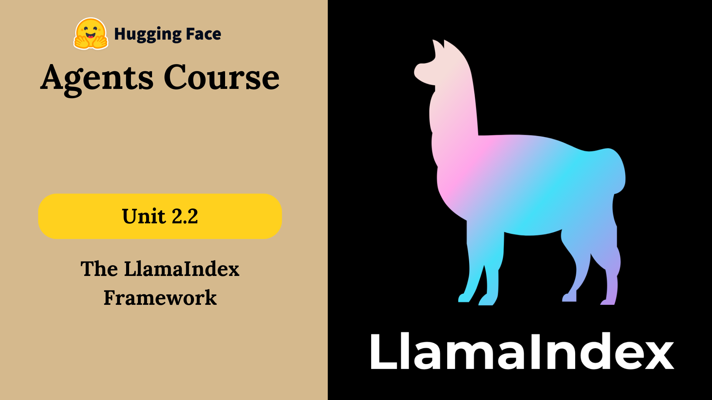

# 18 · Introduction to LlamaIndex { #week-5-introduction }

**Goal:** explain the four parts you will connect this week. Complete [setup](week-5-learning-plan.md#download) first.

Alfred needs to answer questions about a collection of persona descriptions. A model may know many general facts, but it has not automatically read these local files. You will give Alfred a way to search them and use the returned information.

[](images/huggingface-week05/thumbnail.png){ .course-figure-link }

*HF original figure, unchanged. [Source lesson](https://huggingface.co/learn/agents-course/en/unit2/llama-index/introduction) · [Enlarge the figure](images/huggingface-week05/thumbnail.png).*

**The idea in one example:** ask, “Which persona is interested in Cincinnati art?” LlamaIndex helps your program find the relevant text and give it to the model. You will first build that search, then let an agent choose when to use it. Finally, you will connect operations through workflow steps.

## Four parts, four jobs { #four-parts }

| Part | Its job | This week’s example |
| --- | --- | --- |
| Component | Perform one part of an application. | Load files, create embeddings, retrieve passages or generate an answer. |
| Tool | Expose a capability with a name, description and inputs. | Multiply numbers or search the persona collection. |
| Agent | Let a model choose tools and use their results. | Decide between arithmetic and persona lookup. |
| Workflow | Connect steps through typed events and shared state. | Pass a result to the next step, loop once or hand off to another agent. |

An **embedding** is a list of numbers representing text for similarity search. An **index** organizes the stored information so it can be searched. A **query engine** retrieves relevant passages and uses a model to compose an answer. Retrieval supplies evidence; it does not guarantee that the answer is correct.

## Follow the information { #information-flow }

```text
Persona files → text chunks → embeddings → stored index
Question → retrieve relevant chunks → model composes answer
Agent → chooses a tool → receives its result → answers or takes another step
Workflow → event → matching step → another event or a final result
```

These ideas connect to your earlier RAG and tool exercises. Here you will build them with LlamaIndex and inspect each boundary: which part retrieves, which part calls a model, and which part decides what happens next.

LlamaIndex’s workflow system is **event driven**: the kind of event determines which step can run. It is **async first**: `await` waits for an operation’s result without blocking other async work. You do not need to write parallel programs to use it. Each lesson supplies a normal script entry point so you can run `python filename.py`.

## Check your understanding { #check }

Write a short answer in section 18 of `evidence.md`: a program loads files and answers one document question. Does that alone prove it is an agent?

??? success "Answer"

    No. A fixed retrieval-and-answer pipeline can run without an agent deciding which tool to use. Find the decision loop and actual tool calls before calling it an agent.

*Source and adapted examples: [HF Unit 2.2 — introduction](https://huggingface.co/learn/agents-course/en/unit2/llama-index/introduction). Apache-2.0; see the starter’s `NOTICE.md` and `HF-LICENSE.txt`.*

## Stop and check { #checkpoint }

No Python file is added on this page. In section 18 of `evidence.md`, distinguish a component, tool, agent and workflow in your own words. You are ready when you can explain why a fixed document query is not automatically an agent.

**Next:** [19 · LlamaHub](week-5-llamahub.md).
