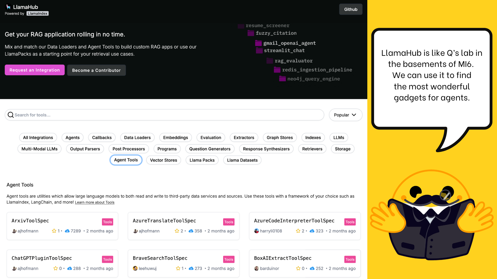

# 19 · Find and use integrations { #week-5-llamahub }

**Goal:** identify the packages that connect your program to a model, embeddings and storage. Use the activated terminal from [setup](week-5-learning-plan.md#environment).

[](images/huggingface-week05/llama-hub.png){ .course-figure-link }

*HF original figure, unchanged. [Source lesson](https://huggingface.co/learn/agents-course/en/unit2/llama-index/llama-hub) · [Enlarge the figure](images/huggingface-week05/llama-hub.png).*

**Read the figure:** LlamaHub is a catalog of ready-made connections. The categories help you find a model connection, a document reader, a database adapter or a tool. You choose the parts your program needs; you do not install the whole catalog.

**In our project:** the Groq integration sends requests to the model, the Hugging Face integration creates local embeddings, and the Chroma integration stores searchable text. The table below connects each package name to its Python import.

## 1. What LlamaHub provides { #integrations }

[LlamaHub](https://llamahub.ai/) is a catalog of integrations. Find a component by the job you need it to do. A package installs the code; a Python import loads that code into your program. The names are related but not identical.

| Job | Package in your requirements | Import used in this week |
| --- | --- | --- |
| Core components and tools | `llama-index-core` | `llama_index.core` |
| Classroom Groq model | `llama-index-llms-groq` | `llama_index.llms.groq` |
| Local Hugging Face embeddings | `llama-index-embeddings-huggingface` | `llama_index.embeddings.huggingface` |
| Chroma vector storage | `llama-index-vector-stores-chroma` | `llama_index.vector_stores.chroma` |
| Workflow drawing | `llama-index-utils-workflow` | `llama_index.utils.workflow` |

You already installed these together in setup. Do not install a second set of packages into your Week 4 environment. A working integration also needs its runtime inputs: the Groq connection needs a key and model ID; local embeddings need model files; storage needs a local directory.

## 2. Test one model request { #connection-test }

**Create `my_llm.py` in `week05-exercises`.** This program reads your local settings, sends the greeting below to Groq, and prints the response in the terminal. It uses an LLM and Groq tokens. It does not index or search any documents.

```python title="my_llm.py"
from week05_common import get_llm, run

async def main():
    llm = get_llm()
    response = await llm.acomplete("Hello, how are you?")
    print(response.text)

if __name__ == "__main__":
    run(main)
```

??? info "Explain the code"

    `get_llm()` loads `.env` and returns the configured Groq integration. `acomplete` is the async completion method; `await` waits for its response. `run(main)` calls `asyncio.run(main())` in the supplied helper, so a normal terminal can execute it. The main guard prevents a model request when another file imports this module.

**Save and run:** `python my_llm.py`.

A short greeting is enough to verify the connection. Wording varies. If it fails, check `.env`, the active environment, network access and model permissions. Do not print the API key. The helper labels a failed run incomplete; save the error category in section 19 of your evidence note.

**Check:** did this program use your persona files? Which line actually requested a model response?

??? success "Answer"

    It did not read persona files. The request happens at `await llm.acomplete(...)`; constructing the integration alone does not request a completion.

*Source and adapted examples: [HF Unit 2.2 — llama-hub](https://huggingface.co/learn/agents-course/en/unit2/llama-index/llama-hub). Apache-2.0; see the starter’s `NOTICE.md` and `HF-LICENSE.txt`.*

## Stop and check { #checkpoint }

| New file to keep | Result to confirm |
| --- | --- |
| `my_llm.py` | A short model greeting appears without an error. |

Do not change this file for the next lesson. If the greeting failed, use [setup troubleshooting](week-5-learning-plan.md#troubleshooting) before the model-dependent exercises. Record the successful greeting or the actual failure in section 19 of your note.

**Next:** [20 · Components and RAG](week-5-components.md).
