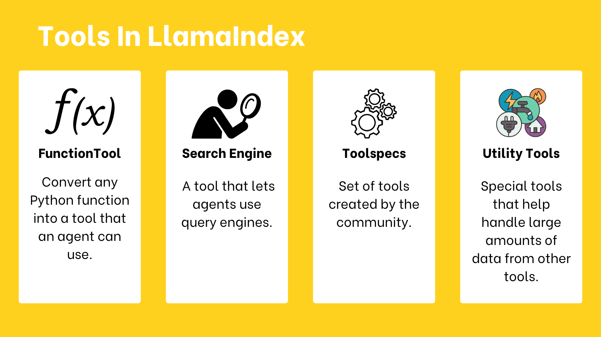

# 21 · Give components a tool interface { #week-5-tools }

**Goal:** make your existing functions and document query engine available through clear tool interfaces. Finish the [components lesson](week-5-components.md#query) first.

[](images/huggingface-week05/tools.png){ .course-figure-link }

*HF original figure, unchanged. [Source lesson](https://huggingface.co/learn/agents-course/en/unit2/llama-index/tools) · [Enlarge the figure](images/huggingface-week05/tools.png).*

**Read the figure:** each card shows a way to make a capability available to an agent. A `FunctionTool` exposes a Python function. A `QueryEngineTool` exposes document search and answering. A `ToolSpec` groups related tools. Utility tools help load or search a large tool result. The figure calls the second card “Search Engine”; our code uses `QueryEngineTool`.

**In our project:** first call the demo weather function yourself. Then call the persona query tool yourself. Later, an agent will choose which tool to call. A tool has a name, inputs and a result; creating one does not create an agent.

## 1. FunctionTool: expose a Python function { #function-tool }

**Create `my_tools.py`.** Following HF’s weather example, it returns a fixed “sunny” string and prints the tool’s name, description and input schema. This is **demo data, not live weather**. It uses no LLM or Groq tokens. Read its terminal output before allowing an agent to use it.

```python title="my_tools.py"
from llama_index.core.tools import FunctionTool


def get_weather(location: str) -> str:
    """Return a fixed classroom weather example, not live weather."""
    print(f"Getting demo weather for {location}")
    return f"The weather in {location} is sunny (demo data)"


weather = FunctionTool.from_defaults(
    get_weather, name="my_weather_tool",
    description="Return fixed demo weather for a location. Not a live forecast.",
)

if __name__ == "__main__":
    print(weather.call("New York"))
    print("NAME:", weather.metadata.name)
    print("DESCRIPTION:", weather.metadata.description)
    print("INPUT SCHEMA:", weather.metadata.fn_schema.model_json_schema())
```

??? info "Explain the function tool"

    `FunctionTool.from_defaults` wraps a Python function. Type annotations describe its inputs; its name and description tell a model what it can do. `weather.call` directly runs the function. The main guard means importing `get_weather` later will not execute these checks. A tool can run without an agent.

**Run:** `python my_tools.py`.

Look for the New York demo message, tool name and a schema containing a string input called `location`. Inside the main guard of this same file, replace only this line:

```text
    print(weather.call("New York"))
```

with:

```text
    print(weather.call("Tokyo"))
```

Keep four leading spaces. Save and run `python my_tools.py` again. Why does the answer remain sunny? After recording the result, restore the New York line and save. Do not change `get_weather` or the tool definition.

??? success "Answer"

    The function always returns the same pattern. It does not contact a weather service. A realistic-looking sentence is not evidence of a live lookup.

## 2. QueryEngineTool: expose your document search { #query-tool }

**Create `my_query_tool.py`.** It wraps the same persona query engine in a named tool, calls that tool directly and prints its result. It uses Groq to compose an answer, but no agent chooses the tool yet. Its inputs are the stored persona index and the question below.

```python title="my_query_tool.py"
from week05_common import get_llm, run
from week05_rag import persona_tool

async def main():
    tool = persona_tool(get_llm())
    print("TOOL:", tool.metadata.name, tool.metadata.description)
    result = await tool.acall("Describe the persona interested in Cincinnati art. Do not invent a real name.")
    print("RETURN:", result)

if __name__ == "__main__":
    run(main)
```

??? info "Explain the query tool"

    Open `week05_rag.py` and find `persona_tool`. It creates an evidence-preserving `QueryEngineTool` with the query engine, name `personas`, a specific description and `return_direct=False`. The description explains the dataset and its limits. The compact query engine uses at most two retrieved chunks. `acall` calls this tool asynchronously. The supplied evidence-preserving `QueryEngineTool` also attaches the response’s original source nodes, labeled **SOURCE** and **EXCERPT**, before the separate **GENERATED ANSWER**. That lets you and the agent distinguish original wording from generated prose. Returning the result to an agent later can lead to another model call to compose the final answer.

**Run:** `python my_query_tool.py`. Compare its result with `my_query.py`. Find `SOURCE: persona_0.txt`, then compare its **EXCERPT** with that file in `data`. Treat text labeled **GENERATED ANSWER** as generated prose, not a quotation. If a source excerpt is clipped, open the file for the rest. Do not count a direct tool call as an agent’s decision.

## 3. ToolSpec: collect related tools { #tool-spec }

HF demonstrates a community `GmailToolSpec`. Connecting Gmail requires its own setup and account permissions. First learn the same collection mechanism with the local weather/arithmetic tools below. This exercise does not connect to an email account.

**Create `my_toolspec.py`.** It groups two Python functions into a tool list and prints each name/description before calling both directly. It uses no LLM, network or Groq tokens.

```python title="my_toolspec.py"
from llama_index.core.tools.tool_spec.base import BaseToolSpec
from my_tools import get_weather

class ClassroomToolSpec(BaseToolSpec):
    spec_functions = ["weather", "multiply"]

    def weather(self, location: str) -> str:
        """Return fixed classroom weather, not a live forecast."""
        return get_weather(location)

    def multiply(self, a: int, b: int) -> int:
        """Multiply two integers."""
        return a * b

tools = ClassroomToolSpec().to_tool_list()
for tool in tools:
    print(tool.metadata.name, "=>", tool.metadata.description)
print(tools[0].call("New York"))
print(tools[1].call(a=2, b=2))
```

??? info "Explain the tool collection"

    `spec_functions` names the methods to expose. `to_tool_list()` creates individual tools from them. A `ToolSpec` is a collection, not an agent. The list can be inspected before it is given to an agent. The method docstrings describe each tool’s purpose.

**Run:** `python my_toolspec.py`. Expect two tool descriptions, demo weather and `4`. Write down why adding tools does not add agents.

### MCP tools { #mcp }

HF next introduces an MCP `ToolSpec`. **MCP** is a protocol for exposing tools from a separate server. The server must exist and be running; installing a client does not create one. The result is still a list of callable tools. This is a reading extension here: no external server or personal account is required to complete the week. See [HF’s tools lesson](https://huggingface.co/learn/agents-course/en/unit2/llama-index/tools) for its Gmail and MCP integration examples.

## 4. Utility tools: avoid handing over huge results { #utility-tools }

A tool can return more text than an agent needs. HF describes two useful patterns:

| Pattern | What it does |
| --- | --- |
| On-demand loader | Load data, index it and answer a query when the tool is called. |
| Load-and-search tool collection | One tool loads/indexes a large result; another searches that stored result for the requested information. |

Both patterns let an agent work with a focused answer rather than repeatedly receiving an entire large response. They may add embedding work, storage and model calls. They do not automatically prove the returned information is correct. Your small persona query tool already demonstrates why retrieved excerpts are easier to inspect than a whole collection.

**Check:** a service returns 100 long records but the user asks about only one. What would a load-and-search tool collection change, and what still needs checking?

??? success "Answer"

    It would index the large result and let the agent search for the relevant part. You would still check whether the selected record supports the answer, whether anything important was omitted, and what model calls or storage were used.

**Checkpoint:** in section 21 of your evidence note, identify a direct function call, a direct query-tool call and a tool collection. None of these alone demonstrates agent tool selection.

*Source and adapted examples: [HF Unit 2.2 — tools](https://huggingface.co/learn/agents-course/en/unit2/llama-index/tools). Apache-2.0; see the starter’s `NOTICE.md` and `HF-LICENSE.txt`.*

## Stop and check { #checkpoint }

| New file to keep | Result to confirm |
| --- | --- |
| `my_tools.py` | Demo weather, a name/description, and a `location` input schema. Restore New York after the comparison. |
| `my_query_tool.py` | A tool return with original SOURCE/EXCERPT text separate from GENERATED ANSWER. |
| `my_toolspec.py` | Two tool descriptions and their direct-call results. |

Keep earlier components files and these three new files. Do not edit supplied helpers. Explain in section 21 of your note why a tool collection is not an agent.

**Next:** [Quiz 1](week-5-quiz-1.md).
