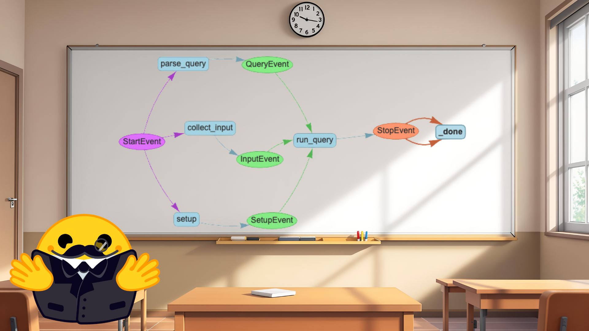
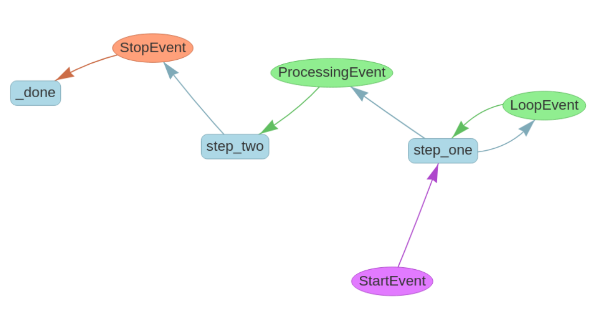

# 23 · Connect steps with events { #week-5-workflows }

**Goal:** control how information moves between steps, then connect that control to an agent team. Follow these sections in order, as in HF. All programs are separate files beside your existing helpers.

[](images/huggingface-week05/workflows.png){ .course-figure-link }

*HF original figure, unchanged. [Source lesson](https://huggingface.co/learn/agents-course/en/unit2/llama-index/workflows) · [Enlarge the figure](images/huggingface-week05/workflows.png).*

**Read the figure:** blue boxes are steps that do work. Colored ovals are events: messages that carry data and make the next matching step eligible to run. Follow a path such as `StartEvent → parse_query → QueryEvent → run_query → StopEvent`. The picture shows a larger workflow; you will start with one step.

**A simple way to picture it:** a step does a job, then passes a labeled message. The label tells the workflow which step can receive it. The message carries the result that the next step needs. You write those connections using event types such as `ProcessingEvent`.

## 1. A one-step workflow { #one-step }

A workflow starts with a `StartEvent`. A matching step receives it and returns another event. A `StopEvent` ends the run and carries its result. `@step` registers a method; type annotations tell the workflow which events it accepts and emits.

**Create `my_workflow.py`.** It runs one step and prints “Hello, world!” in the terminal. It uses no LLM, network or Groq tokens. The only input is the workflow’s start event.

```python title="my_workflow.py"
from llama_index.core.workflow import StartEvent, StopEvent, Workflow, step
from week05_common import run

class MyWorkflow(Workflow):
    @step
    async def my_step(self, ev: StartEvent) -> StopEvent:
        return StopEvent(result="Hello, world!")

async def main():
    print(await MyWorkflow(timeout=10, verbose=False).run())

if __name__ == "__main__":
    run(main)
```

??? info "Explain the start and stop"

    The `StartEvent` annotation connects the start of the run to `my_step`. Returning `StopEvent(result=...)` finishes the run. `await ...run()` returns its result, which `print` displays. `run(main)` supplies the ordinary Python script entry point; this is why no notebook-only top-level `await` is needed.

**Run:** `python my_workflow.py`. Expect `Hello, world!`. What part used an LLM?

??? success "Answer"

    None. A workflow can organize plain Python operations. An event-driven workflow is not automatically an AI agent.

## 2. Connect two steps { #two-steps }

**Follow one message:** `StartEvent → step_one → ProcessingEvent → step_two → StopEvent`. `step_one` writes “Step 1 complete” into the message. `step_two` reads that same text and adds “Finished processing:”. The event type connects the steps; Python does not choose the next step just because it is next in the file.

**Create `my_workflow_steps.py`.** The first step puts a string into a custom `ProcessingEvent`. The second step reads it and prints the completed result. It uses no LLM, network or Groq tokens. Follow the event payload between the two methods.

```python title="my_workflow_steps.py"
from llama_index.core.workflow import Event, StartEvent, StopEvent, Workflow, step
from week05_common import run

class ProcessingEvent(Event):
    intermediate_result: str

class MultiStepWorkflow(Workflow):
    @step
    async def step_one(self, ev: StartEvent) -> ProcessingEvent:
        return ProcessingEvent(intermediate_result="Step 1 complete")

    @step
    async def step_two(self, ev: ProcessingEvent) -> StopEvent:
        return StopEvent(result=f"Finished processing: {ev.intermediate_result}")

async def main():
    print(await MultiStepWorkflow(timeout=10, verbose=False).run())

if __name__ == "__main__":
    run(main)
```

??? info "Explain event routing"

    The first step returns a `ProcessingEvent`, which matches the input annotation of `step_two`. The `intermediate_result` field is the data passed between them. The event types connect the steps; their names and placement in the file are not the routing rule.

**Run:** `python my_workflow_steps.py`. Expect `Finished processing: Step 1 complete`.

In the same file, find the return line inside `step_one` and replace it with this exact line, keeping eight leading spaces:

```text
        return ProcessingEvent(intermediate_result="Step 1 changed by the student")
```

Save and rerun `python my_workflow_steps.py`. Expect `Finished processing: Step 1 changed by the student`. Explain why step two changed without editing that method. After recording the result, restore and save this original line:

```text
        return ProcessingEvent(intermediate_result="Step 1 complete")
```

## 3. Branch and loop { #loop }

HF demonstrates a step that can either loop or continue. Here the example loops exactly once so you can predict and inspect both paths. The timeout provides a second bound; do not create an unlimited retry loop.

**Create `my_workflow_loop.py`.** It returns a `LoopEvent` on its first attempt, then a `ProcessingEvent` that allows the second step to finish. Its input is the initial start event; the event carries the attempt counter. It prints the branch decisions and final result without an LLM or network.

```python title="my_workflow_loop.py"
from llama_index.core.workflow import Event, StartEvent, StopEvent, Workflow, step
from week05_common import run

class LoopEvent(Event):
    attempt: int

class ProcessingEvent(Event):
    intermediate_result: str

class LoopWorkflow(Workflow):
    @step
    async def step_one(self, ev: StartEvent | LoopEvent) -> ProcessingEvent | LoopEvent:
        attempt = ev.attempt if isinstance(ev, LoopEvent) else 0
        if attempt < 1:
            print("Try again once")
            return LoopEvent(attempt=attempt + 1)
        print("Continue to step two")
        return ProcessingEvent(intermediate_result="First step complete")

    @step
    async def step_two(self, ev: ProcessingEvent) -> StopEvent:
        return StopEvent(result=f"Finished processing: {ev.intermediate_result}")

async def main():
    print(await LoopWorkflow(timeout=10, verbose=False).run())

if __name__ == "__main__":
    run(main)
```

??? info "Explain the loop"

    `StartEvent | LoopEvent` means this step accepts either event type. On the first call the attempt is zero. Returning `LoopEvent(attempt=1)` routes back to the same step; that field prevents another loop. Returning `ProcessingEvent` takes the other branch and reaches `step_two`. A loop in a program does not imply an API rate-limit retry.

**Predict the output, then run:** `python my_workflow_loop.py`.

```text
Try again once
Continue to step two
Finished processing: First step complete
```

In your evidence, identify the event that caused the repeat and the event that allowed progress.

## 4. Draw the possible paths { #draw }

[](images/huggingface-week05/workflow-draw.png){ .course-figure-link }

*HF original figure, unchanged. [Source lesson](https://huggingface.co/learn/agents-course/en/unit2/llama-index/workflows) · [Enlarge the figure](images/huggingface-week05/workflow-draw.png).*

**Read the figure:** start at `StartEvent` and follow its arrow to `step_one`. A `LoopEvent` sends work back to that same step. A `ProcessingEvent` sends work onward to `step_two`, which returns `StopEvent`. `_done` is the framework’s final internal step.

**Match it to your program:** our first attempt takes the loop; the next attempt continues and finishes. The picture shows possible routes, while your terminal shows the route that actually ran. Your generated drawing may have a different layout.

**Create `my_workflow_draw.py`.** It inspects the workflow class from your previous file and writes `flow.html` beside the programs. It does not run the workflow or use an LLM. Its result is a diagram you can open in your browser.

```python title="my_workflow_draw.py"
from my_workflow_loop import LoopWorkflow
from week05_common import ROOT, save_diagram

if __name__ == "__main__":
    save_diagram(LoopWorkflow, ROOT / "flow.html")
    print("Saved flow.html. Open it yourself in your browser.")
```

??? info "Explain the drawing"

    `save_diagram` uses HF’s `draw_all_possible_flows` utility to export the registered step/event connections. The supplied helper saves the HTML without trying to launch your computer’s browser. Importing `LoopWorkflow` does not run its `main`, because that file has a main guard. The diagram shows possible structure, not a record proving which path a particular execution took.

**Run:** `python my_workflow_draw.py`. Wait for `Saved flow.html. Open it yourself in your browser.` The program will not open a browser automatically. Open `week05-exercises/flow.html` in File Explorer/Finder and double-click it. The diagram fits itself after the layout settles. If any node is off-screen, click **Fit diagram** below the drawing. Drag empty space to pan; scroll or pinch to zoom. Find the loop back to the first step and the route to the stop event. Keep a screenshot in your evidence folder if useful. Compare the diagram with your actual three-line trace. The saved file includes its graph libraries, so viewing it needs no internet.

??? help "The file is missing or the diagram is blank"

    Run `python week05_common.py` and check for **2026-11-10.2**. Update only the helper from the current ZIP if needed, then rerun `python my_workflow_draw.py`. Wait for `Saved flow.html...` and open that newly saved file in a browser. Its position/layout can differ from HF’s picture.

    If Python reports `No module named pyvis`, activate this week’s `.venv` and run `python -m pip install -r requirements.txt`. Check installation with `python -m pip show pyvis`; the requirements pin **0.3.2**. If the saved file remains blank, try another browser and share the filename and error with your instructor.

## 5. Keep shared state with Context { #state }

**Think of `Context` as a shared notebook for this workflow run.** An event carries a message to a matching step. Context stores information that later steps can look up by name. Here, the program writes a question under the name `query`, then reads it back. This state is kept in memory for the run; it is not a saved file.

**Create `my_workflow_state.py`.** It stores HF’s France-capital question, retrieves the same string in a later step and reads it again after the run. It prints the stored query and a completion message. It does not answer the question, contact an LLM or use Groq tokens.

```python title="my_workflow_state.py"
from llama_index.core.workflow import Context, Event, StartEvent, StopEvent, Workflow, step
from week05_common import run

class ProcessingEvent(Event):
    intermediate_result: str

class StateWorkflow(Workflow):
    @step
    async def step_one(self, ctx: Context, ev: StartEvent) -> ProcessingEvent:
        await ctx.store.set("query", "What is the capital of France?")
        return ProcessingEvent(intermediate_result="Step 1 complete")

    @step
    async def step_two(self, ctx: Context, ev: ProcessingEvent) -> StopEvent:
        query = await ctx.store.get("query")
        print("STORED QUERY:", query)
        return StopEvent(result=f"Finished processing: {ev.intermediate_result}")

async def main():
    workflow = StateWorkflow(timeout=10, verbose=False)
    ctx = Context(workflow)
    print(await workflow.run(ctx=ctx))
    print("STATE AFTER RUN:", await ctx.store.get("query"))

if __name__ == "__main__":
    run(main)
```

??? info "Explain shared state"

    `ctx.store.set` writes a named value; `ctx.store.get` reads it. Both steps receive the same run context. The final read uses that same context after completion. The `ProcessingEvent` still routes the workflow; context stores shared information alongside that event flow.

**Run:** `python my_workflow_state.py`. Find `What is the capital of France?` twice. Did any code establish that the answer is Paris?

??? success "Answer"

    No. This program stores and reads a question. It contains no lookup or model operation that answers it. A printed question is not evidence that a task was solved.

## 6. Automate a team workflow and count calls { #agent-workflow }

Finally HF returns to an agent team: multiplication and addition agents, a root agent and shared state. This connects the workflow ideas to the model-driven decisions from the previous lesson.

**Create `my_team_workflow.py`.** It sends HF’s addition question to the multiplication agent first. That agent should hand off to the addition agent, which calls `add`. The arithmetic tools update a shared counter. It uses Groq tokens and prints the tool trace, final answer and arithmetic-call count.

```python title="my_team_workflow.py"
from llama_index.core.agent.workflow import AgentWorkflow, FunctionAgent
from llama_index.core.workflow import Context
from week05_common import get_llm, run, show_agent

async def add(ctx: Context, a: int, b: int) -> int:
    """Add two integers and count this arithmetic call."""
    state = await ctx.store.get("state")
    state["num_fn_calls"] += 1
    await ctx.store.set("state", state)
    return a + b

async def multiply(ctx: Context, a: int, b: int) -> int:
    """Multiply two integers and count this arithmetic call."""
    state = await ctx.store.get("state")
    state["num_fn_calls"] += 1
    await ctx.store.set("state", state)
    return a * b

async def main():
    llm = get_llm()
    multiplier = FunctionAgent(
        name="multiply_agent", description="Multiplies two integers.", tools=[multiply], llm=llm,
        can_handoff_to=["add_agent"],
        system_prompt="Use multiply for multiplication. Hand all addition requests to add_agent.",
    )
    adder = FunctionAgent(
        name="add_agent", description="Adds two integers.", tools=[add], llm=llm,
        can_handoff_to=["multiply_agent"],
        system_prompt="Use add for addition. Return the result from the tool.",
    )
    workflow = AgentWorkflow(
        agents=[multiplier, adder], root_agent="multiply_agent", timeout=180,
        initial_state={"num_fn_calls": 0},
        state_prompt="Current state: {state}. User message: {msg}",
    )
    ctx = Context(workflow)
    await show_agent(workflow, "Can you add 5 and 3? Hand off to add_agent and use add.", ctx=ctx)
    state = await ctx.store.get("state")
    print("ARITHMETIC CALLS:", state["num_fn_calls"])

if __name__ == "__main__":
    run(main)
```

??? info "Explain the team state"

    `initial_state` sets a shared dictionary with a zero count. Each arithmetic tool receives `ctx`, increments the counter and stores it again. Context is injected by the framework; it is not a number supplied by the model. `state_prompt` makes the current state available with the user message. Only the arithmetic functions increment this counter: it does not count model requests, handoffs or tokens. This example uses a sequential handoff; concurrent state updates would need additional coordination.

**Run:** `python my_team_workflow.py` once.

Check these separately: a handoff to `add_agent`, an `add` call with `5` and `3`, return value `8`, a final answer consistent with `8`, and `ARITHMETIC CALLS: 1` for one arithmetic call. If the count is greater than one, inspect the trace for repeated arithmetic calls. A count alone does not identify which tool ran or prove the answer is correct.

**Compare:** which of this lesson’s programs can run without Groq? Which one lets a model decide the route? In section 23 of your evidence note, draw the difference between an event-triggered step and an agent-selected tool call.

*Source and adapted examples: [HF Unit 2.2 — workflows](https://huggingface.co/learn/agents-course/en/unit2/llama-index/workflows). Apache-2.0; see the starter’s `NOTICE.md` and `HF-LICENSE.txt`.*

## Stop and check { #checkpoint }

| New file to keep | Result to confirm |
| --- | --- |
| `my_workflow.py` | Hello result, no LLM. |
| `my_workflow_steps.py` | Event payload reaches step two; restore the original line after comparison. |
| `my_workflow_loop.py` | Exactly one repeat before completion. |
| `my_workflow_draw.py` | `flow.html` is saved without launching a browser. Keep `my_workflow_loop.py`, which it imports. |
| `my_workflow_state.py` | The same stored question appears during and after the run. |
| `my_team_workflow.py` | Handoff, `add(5,3)`, result `8`, and an arithmetic counter consistent with the trace. |

Only the last of these six programs needs Groq. Keep your earlier files and save results in section 23 of your note. Draw the event route beside the actual printed trace; the diagram alone is not execution evidence.

**Next:** [Quiz 2](week-5-quiz-2.md).
